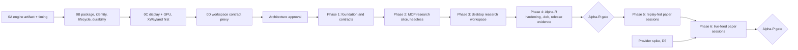

# Clipper Alpha: phased delivery and release gates

**Status:** proposed for review under issue #1. This is a plan, not a backlog
or a commitment. Revision 3 (2026-11-25) addresses the Codex review, and
revision 3.1 applies decisions D13–D21.

**Assumptions:**
- one Linux reference machine (`overview.md` §13);
- two coding agents plus an independent reviewer;
- synthetic and user-supplied data;
- no paid data until Alpha-P stage 2.

Agent hours are not engineering throughput.

## Milestones

| Phase | Scope | Depends on | Exit gate |
|---|---|---|---|
| 0 | The [validation spike](desktop-validation.md), as proofs 0A–0D, reported independently. Codex confirms revision 3.1. | none | Every proof recorded as PASS, FAIL or NOT RUN; Go criteria met, or failures escalated to the maintainer (D13, D17); ADRs accepted or amended. |
| 1 | Monorepo with locked uv, npm and Cargo dependencies. Restricted engine wheel build in CI. CI covering lint, types, tests, licence and secret scans. Domain DTOs, the approval envelope, API and stream schemas. The grant model and capability matrix. `app.db` migrations. Worker launcher with launch intents. Trading adapter skeleton. | Phase 0 | Fresh checkout builds. Engine smoke runs from the restricted wheel. The artifact inspection gate is in CI. OpenAPI client generated. |
| 2 | **MCP-first research slice (D4).** Dataset import from staged roots, validation, catalog, coverage. Strategy registration (snapshot, static validation) with **human acknowledgement through the CLI**. Deterministic backtest worker with the `after_watermark` timing default. Results and trade log from the typed projection. Exposed through MCP grants, then the CLI. | Phase 1 | Claude Code and Codex complete journey 1, including the CLI acknowledgement step. The expected-ledger fixture passes. Parallel jobs and cancellation work. Invocation and denial tests pass for each grant. |
| 3 | **Desktop research workspace.** Shell with identity proof and attach. One docked window. Chart with indicators computed in the service, plus results and trade markers. Workspace state and the stream contract. MCP workspace tools. Tray. Then detachable windows and restore under XWayland. | Phase 2; 0B and 0C | Journeys 2 and 3 pass. Windows converge. Stale revisions and epoch changes behave as specified. Performance protocol run in the webview. Desktop E2E passes. |
| 4 | **Alpha-R hardening.** `.deb` with versioned prefixes. Upgrade with active work; uninstall. Backup and restore. Local web defences. **Release evidence** (payload inventory, checksums, source mapping, notices, AGPL source, tested LGPL override; source only as the licences require; maintainer and legal review, D20). Docs and known limitations. | Phase 3 | **Alpha-R gate.** |
| 5 | **Paper sessions fed by replayed data.** Session worker. Outbox, receipt and outcome chain. `flock` lease; terminal takeover and sealing. Intents and approvals (desktop and CLI). Clipper limits and exposure reservation. Stop, cancel, flatten and emergency stop for humans. `paper:halt` for MCP (D15). MCP paper tools. Logout ends sessions and cancels open orders; upgrades wait (D16). | Alpha-R | Durability fault suite passes. Approval tests pass. Exactly one terminal record per session. |
| 6 | **Live-feed paper sessions.** One provider adapter. Decide where the feed client lives before credentials arrive (ADR-010). Staleness blocking and badges. Retention per licence (D19). | Phase 5; provider spike | **Alpha-P gate.** |
| Later | Paper resume; WebAuthn and protected approval; strategy isolation; multi-file strategies; drawing tools; editor; optimization; screener; Windows; Cloud; broker paper accounts. | separate | Their own ADRs and reviews. |

**Effort:** no schedule is given until Phase 0 reports; Phase 0 itself is
timeboxed at 4–8 working days. Estimate Alpha-R and Alpha-P separately from
its results. No beta or real-money date is promised.

## Workstream handoffs

- **Foundation:** DTOs, the approval envelope, OpenAPI, the grant model and
  contract tests come first.
- **Trading and data:** restricted wheel, adapter, specifications, catalog,
  fixtures, workers and journal. The UI never invents financial results.
- **MCP and CLI:** grants, tools, host configuration, the acknowledgement CLI.
  This stream is the first consumer of every contract.
- **Desktop:** shell, identity proof, lifecycle, packaging, windows, and the
  shared React workspace.
- **Independent reviewer:** adversarial and fault tests. Never reviews their
  own code. Shared contracts change only through review.

## Alpha-R gate

- [ ] Phase 0 evidence reviewed; any escalations decided by the maintainer.
- [ ] The engine artifact passes inspection: no real-account execution factory, provenance recorded (D13).
- [ ] Clean `.deb` install on the reference machine. Service, CLI and MCP all run without a development environment. Works offline with fixtures. Upgrade with active work and uninstall keep data.
- [ ] Identity proof and authenticated reads, writes and subscriptions work on the installed package. Spoofed listeners are rejected, and concurrent clients work.
- [ ] Lifecycle: single instance, last-window detach with tray, shell crash, service restart with adoption, explicit drain, logout ending sessions (D16).
- [ ] MCP from Claude Code and Codex: invocation tests for each grant, denial tests, the CLI acknowledgement step, and jobs that survive the host exiting.
- [ ] Docked workspace, then detached charts restored on two monitors under XWayland. Wayland limits documented.
- [ ] Fixtures validate. Calendar, half days, DST, instrument metadata, the close-to-open display mapping and markers by execution time are all correct.
- [ ] Financial fixtures pass through the packaged engine: `after_watermark` timing, order-level fee caps, effective-dated fees, precision and tick validation, insufficient cash, competing stop and target orders, split refusal, and the independent ledger.
- [ ] The UI shows candles, volume, service-computed indicators, markers, equity, drawdown and warnings, each linked to its manifest.
- [ ] The performance protocol runs in the webview under XWayland on the reference GPU.
- [ ] Webview least privilege: the commands manifest, per-window capabilities, navigation denial, CSP and token handling.
- [ ] Release evidence complete, with a tested LGPL override and source provided as the licences require. Maintainer and legal review completed (D20). Lightweight Charts' NOTICE taken from its tag.
- [ ] Threat model and audit-chain limits published. The maintainer approves the release.

## Alpha-P gate

- [ ] Paper sessions run from a replay feed, then a live feed. The artifact gate still holds.
- [ ] The approval envelope is bound to its digest. Expiry, replay, tampering, cross-session and MCP-refusal tests pass. Red-team record kept.
- [ ] Durability: kills at every boundary, lost and concurrent retries, gateway restart while a worker lives, disk full and abrupt power loss. Nothing is published before its commit. Exactly one terminal record. Sealed journals refuse writes.
- [ ] Clipper limits and exposure reservation hold. Price collars are enforced as limit prices. A stale feed blocks orders.
- [ ] Human stop, cancel, flatten and emergency stop, plus MCP `paper:halt` (D15), report actual outcomes.
- [ ] Closing windows and disconnecting the agent do not stop a session. Logout cancels open orders, ends the session and preserves history; upgrades wait until sessions have stopped (D16).
- [ ] Cache database backing is disabled. Provider terms reviewed. Retention flags are correct (D19). No paid keys in CI.

## Risk register

| Risk | Severity | Mitigation / decision gate |
|---|---|---|
| Restricted engine build infeasible or costly to maintain | High | Proof 0A; propose per-adapter features upstream; escalate to the maintainer if infeasible. D1 stays (D13). |
| Same-close fills or other timing look-ahead | High | `after_watermark` default; 0A timing fixture; independent ledger. |
| Lost or duplicated paper events | High | Outbox, receipt and outcome chain; `FULL` durability; fenced takeover; fault suite. |
| WebKitGTK on the NVIDIA proprietary driver | High | XWayland-first matrix in 0C. On failure, escalate to the maintainer before evaluating CEF or Wayland (D17). |
| Packaged Python prefix breaks after install | High | Build at the final path, verify build paths and ELF dependencies, clean-install test in 0B. |
| WebSocket auth or origin behaviour in WebKitGTK | High | Stream tickets; actual origins recorded in 0B; a Rust bridge if the origin is opaque. |
| Nautilus v2 RC churn | High | Exact pin; adapter confined; fixture suite on every pin change. |
| LGPL or AGPL distribution obligations | High | Release evidence; tested override; maintainer and legal review before every release (D20). |
| Same-user agent bypass | High (accepted for alpha, D2) | Threat model, grants, audit limits disclosed; protected approval later. |
| Secrets or licensed data in the public repository | High | Ignore rules, secret scanning, synthetic CI data. |
| Wayland placement and Tauri 3 migration | Medium | XWayland default; thin shell; 2.12.x pin. |
| Equity feed cost or licensing | Medium | Free data first; paid feed only in stage 2; retention policy (D19). |
| Windows portability debt | Medium | Interfaces from ADR-018, including the Job Object supervisor; Windows spike before scheduling. |
| Overbuilding | Medium | MCP first; proofs before polish; one docked window before detached windows. |

## Backlog after approval (not created yet)

Foundation and CI, including the restricted engine build; trading adapter and
specifications; data import, calendars and catalog; strategy snapshots and
acknowledgement; MCP grants and CLI; backtesting and financial verification;
desktop shell, identity, lifecycle and packaging; workspace, streams and
charting; paper sessions, outbox, journal and takeover; approvals and limits;
release evidence, licensing and security hardening. Later: resume, protected
approval, isolation, drawing tools, editor, Windows, Cloud. Each issue needs a
testable gate, dependencies, an owner, non-goals and evidence. Create the
epics only after maintainer sign-off.
