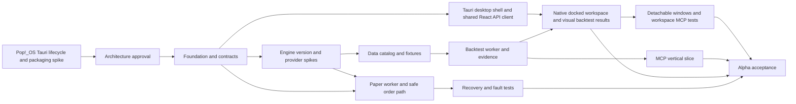

# Clipper Alpha 0.1 — phased delivery and release gates

Status: proposed for review in #1. This is a planning document, not a backlog or implementation commitment. Scope and estimates assume one maintained Pop!_OS 24.04 desktop deployment, two coding agents plus independent review, readily available synthetic data, and a supported live data feed. Parallelize only once contracts are agreed; do not interpret agent hours as verified engineering throughput.

## Critical path

| Phase | Scope and dependencies | Rough elapsed effort | Exit gate |
|---|---|---|---|
| 0 | Reconcile independent critique; run isolated desktop lifecycle/packaging spike before plan approval; maintainer approve; no substantive features | 1–2 days review + 2–5 days spike provisional | Desktop spike evidence and blocker report, decisions accepted, remaining blockers assigned or resolved |
| 1 | Monorepo, locked uv/npm/Cargo deps, CI, domain DTOs, API and event schemas, auth, supervisor skeleton, native shell foundation; evaluate exact Nautilus/CPython/MCP pins and data provider | 2–4 days | Fresh Linux setup, engine smoke with synthetic dataset, capability report, verified SDK connectivity, no real-money adapter |
| 2 | Import/catalog validation, instrument registry, versioned strategy and run manifests; deterministic backtest worker; REST/CLI/MCP job interface. single-window Tauri shell and dockable React UI in parallel | 4–7 days | Known expected ledger fixture passes; two isolated jobs, cancellation and results from MCP; chart renders fixture in native desktop; MCP reads and changes workspace state |
| 3 | Chart trade markers, metrics and strategy editor; paper account, live read-only feed, sandbox engine, approved manual order and bounded strategy deployment | 5–10 days | Same strategy source used in both modes, real feed labeled correctly, audited paper lifecycle, no route to brokerage |
| 4 | Detachable windows, multi-monitor restore, native packaging and upgrade; recovery/fault tests, strategy isolation, permissions, performance, install docs, E2E | 5–10 days + 3–7 desktop days provisional | All alpha gates below, unresolved failures surfaced; maintainer release decision |
| Later | Advanced indicators/drawings, screening, replay, optimization, broader instruments, Cloud, broker paper, live brokerage | separate estimate | Separate acceptance and risk reviews |

The earlier 3–5 week alpha estimate is withdrawn pending the desktop spike and reconciliation of Claude's critical findings. Desktop work adds a provisional 2–5 working days for validation and 3–7 days for native packaging/window completion, with potential overlap; not a measured schedule. Re-estimate the research and paper milestones separately after the spike, including provider, engine, recovery, security and reviewer availability. Do not count browser product polish in Alpha 1. No public beta or real-money date is promised.

## Workstream handoffs

- Foundation owner defines Pydantic DTOs, OpenAPI generation and test contracts before other agents implement.
- Trading/data agent owns instrument mapping, catalog, fixtures, engine adapter and worker; UI never invents financial results.
- UI agent owns Tauri shell/window integration, shared React workspace, chart rendering, watchlist, results and approval panel against contract fixtures and then real service.
- MCP/CLI agent owns host setup, scoped API access, job control and typed tools; cannot bypass policy.
- Independent reviewer owns adverse test cases, not implementation approvals of its own code. Keep changes small, use CI and record evidence; do not let agents repeatedly change shared contracts without review.

## Alpha release checklist

- [ ] Pre-approval [desktop validation spike](desktop-validation.md) evidence reviewed; unresolved blockers require explicit decision.
- [ ] Clean Pop!_OS 24.04 install from native package with pinned dependencies, no browser/Node/dev setup required; offline synthetic fixture works without credentials. Browser harness remains dev/test only.
- [ ] Native shell starts/attaches to one authenticated service; second launch cannot duplicate it; window close and shell crash preserve active work, reopen resynchronizes, explicit stop reports actual state. Test headless CLI/MCP with no window.
- [ ] Dockable layout in first vertical slice; detachable native charts on multiple monitors before desktop alpha completion, with resize/DPI and monitor removal recovery; Wayland/X11 limitations documented.
- [ ] Version-specific evidence for backtest and sandbox Python adapters, provider coverage and supported order types. Unsupported features explicitly rejected.
- [ ] Import and validate minute/daily fixtures; symbol, time zone, calendar, sessions and immutable snapshot hashes correct.
- [ ] Register example Python strategy with source hash; run backtest via CLI, MCP and desktop; inspect same results by ID, with fee and fill-model assumptions.
- [ ] Independently expected order/fill/accounting fixtures pass; test future data mutation does not alter prior decisions, timestamp availability, duplicate/missing data, commissions, quantity/price precision, insufficient cash, no fabricated intrabar ordering. Two repeat runs produce equivalent normalized artifacts.
- [ ] UI shows candles, volume, trade markers, equity curve, net and gross returns, drawdown, trades and warnings; results link to manifest. No mock financial numbers shown as live.
- [ ] MCP handshake and smoke from both Claude Code and Codex; tools list, job submit/status/results, cancellation, inspect active charts/layouts, change symbols/timeframes/indicators and layout under separate workspace scope, paper account view. Native windows converge to shared state; stale revisions rejected; no-window mutations persist and report pending presentation. Pagination, redaction and permission denial verified.
- [ ] Real-time read-only provider feed drives sandbox fills; no outbound real-order adapter or route exists. Live data gap/staleness blocks new paper orders.
- [ ] Paper order approval bound to exact intent; expiry, replay, tampering, cross-account and scope tests. Standing strategy grant bounded; loss, notional, order rate and duration enforced outside strategy code.
- [ ] Paper worker continues when UI/MCP disconnects. Crash at submit/ack/fill/persist boundaries either restores correctly with evidence or halts recovery-required. No double fill, unreported reset, false success or unsafe automatic retry.
- [ ] Emergency stop, cancel working orders and separate flatten authorization tested; actual results reported rather than guaranteed.
- [ ] Trusted strategy-only fallback until isolated execution passes tests for secret/file/network access, process escape, CPU/memory and malicious output; no untrusted strategy uploads by default.
- [ ] UI performance measured on declared hardware against targets; local API tokens, origin restrictions, log redaction, backups and restore verified.
- [ ] License inventory, TradingView attribution, dataset entitlement documented; no unauthorized dataset in repository/release.
- [ ] Explicit exclusions and known limitations published, maintainer approves release.

## Risk register

| Risk | Severity | Mitigation / decision gate |
|---|---|---|
| 1.x / 2.x API incompatibility | High | Timebox spike, exact pin and matching docs, adapter tests; don't write cross-version abstraction prematurely |
| Inadequate equity feed or licensing | High | Compare candidates early; synthetic research slice independent; no provider claim before test/terms review |
| Sandbox restart cannot restore matching state | High | Durable journal plus safe halt; prove recovery before auto-resume; maintainer decide if limitation acceptable |
| Look-ahead/survivorship/intrabar assumptions | High | Independent fixtures, dataset provenance, explicit availability/calendar and conservative fill policy |
| AI generated code or prompt injection bypass | High | No arbitrary execution or direct DB access, restrict worker identity and network, explicit approvals and trusted sources |
| Duplicate commands or stale feed | High | Idempotency, leases, sequenced events, fail closed on ambiguity, fault injection |
| Public repository secrets or licensed data | High | Ignore rules, secret scan, synthetic CI data, review history before release |
| Native packaging / display server | High | Pop!_OS spike before plan approval; test WebKitGTK, wheel compatibility, Wayland/X11 and independent lifecycle; document packaging fallback for development only |
| Overbuilding frontend or cloud | Medium | One docked native workspace first; detachable windows incremental; browser product polish, cloud auth, billing and scale later |
| Agent coordination and resource contention | Medium | Small workstreams, shared contracts, max two coding agents initially, review gates |

## Suggested backlog after design approval (not created yet)

Foundation and CI; desktop shell, lifecycle and packaging (within charting/UI or separate epic after approval); NautilusTrader adapter; market data and quality; MCP/CLI; backtesting and financial verification; paper trading and recovery; charting/UI; strategy development; indicators/drawings; research/optimization; watchlists/screener; cloud readiness/security; future live brokerage. Each issue needs a testable acceptance gate, dependencies, ownership, explicit non-goals and evidence. Create epics after maintainer sign-off, not from this draft alone.

## Review status

Desktop-first changes implement the maintainer direction on PR #2, not a blanket acceptance of other architecture decisions. Claude's independent critique remains to be reconciled, including engine pin, paper recovery/replay, authorization and same-user threat model, strategy isolation, contributor policy and phase scope. Do not approve the plan or create feature issues until these and the desktop spike have been addressed.
