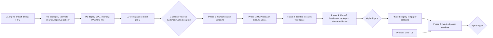

# Clipper Alpha: phased delivery and release gates

**Status:** proposed for review under issue #1. This is a plan, not a backlog
or a commitment.

**Revision 4 (2026-11-25)** addresses the Codex follow-up review and applies
D22–D26. **Acceptance rule:** the ADRs are accepted on Phase 0 evidence, not on
further document review.

**Assumptions:**
- one Linux reference machine;
- two coding agents plus an independent reviewer;
- synthetic and user-supplied data;
- no paid data until Alpha-P stage 2.

Agent hours are not engineering throughput.

## Milestones

| Phase | Scope | Depends on | Exit gate |
|---|---|---|---|
| 0 | The [validation spike](desktop-validation.md): proofs 0A–0D, each reported on its own. | none | Every check is PASS, FAIL or NOT RUN. Every FAIL is escalated and decided. ADRs accepted or amended on the evidence. |
| 1 | Monorepo with locked uv, npm and Cargo dependencies. The restricted engine build and its inspection gate in CI. CI covering lint, types, tests, licences and secret scans. DTOs, the approval envelope and the controller model. API, change-log and stream-cursor schemas. Grant model and capability matrix. Unix-socket and loopback listeners. `app.db` migrations. Worker launcher with intents and leases. Adapter skeleton with the timing mechanism chosen in 0A. | Phase 0 | Fresh checkout builds. Engine smoke tests run from the restricted wheel. Inspection gate is green. OpenAPI client generated. |
| 2 | **MCP-first research (D4).** Import from staged roots, validation, corporate-action coverage, catalog. Strategy snapshots with structural validation, plus **CLI acknowledgement**. Deterministic backtests with `after_watermark`, attribution and FIFO. Results and trade log. Exposed through MCP grants, then the CLI. | Phase 1 | Claude Code and Codex complete journey 1. Independent-ledger and counterexample fixtures pass. Invocation and denial tests pass for every grant. |
| 3 | **Desktop research workspace.** Shell over the Unix socket; one docked window; service-computed indicators; results and markers; workspace with durable cursors; MCP workspace tools; tray. Then detachable windows and restore under XWayland. | Phase 2; 0B and 0C | Journeys 2 and 3 pass. Windows converge. Stale revisions and restarts behave as specified. D26 targets met. Desktop E2E passes. |
| 4 | **Alpha-R hardening.** Side-by-side runtime packages, activation fence, prune. Upgrade while backtests are active. Uninstall. Backup and restore. Local web defences. **Release evidence**, plus the LGPL override test. Docs. | Phase 3 | **Alpha-R gate.** |
| 5 | **Replay-fed paper sessions.** Controller model and control transfer. Outbox, receipt, outcome and publication chain. Lease, terminal record and seal. Intents and approvals. Pre-trade gate. Human stop, cancel, flatten and emergency stop. MCP `paper:halt`. Logout drain with 30 s timeout and supervised shutdown. Upgrades wait for sessions. | Alpha-R | Paper fault suite, controller and logout tests, and halt tests pass. |
| 6 | **Live-feed paper sessions.** One provider. Decide where the feed client runs before credentials arrive. Staleness handling. Retention and export filter under the provider licence (D25). | Phase 5; provider spike | **Alpha-P gate.** |
| Later | Session resume; protected approval; isolation; multi-file strategies; drawings; editor; optimization; Windows; Cloud (including sessions that run independently of a login); broker paper. | separate | Each gets its own ADRs and review. |

**Effort:** no schedule until Phase 0 reports (timebox: 6–10 working days).
Alpha-R and Alpha-P are then estimated separately from the evidence. No beta
or real-money date is promised.

## Workstream handoffs

- **Foundation:** DTOs, the approval envelope, the controller model, OpenAPI,
  change-log and cursor schemas, the grant model and contract tests come
  first.
- **Trading and data:** the restricted build, adapter, timing mechanism,
  attribution, FIFO, specifications, corporate actions, workers, journal and
  sealing. The UI never invents financial results.
- **MCP and CLI:** grants, tools, host configuration, the acknowledgement
  command and the control CLI. This stream is the first consumer of every
  contract.
- **Desktop:** shell, channels, lifecycle, packages, windows and the React
  workspace.
- **Independent reviewer:** adversarial and fault tests. Never reviews their
  own code. Shared contracts change only through review.

## Alpha-R gate

**Phase 0 and engine:**
- [ ] Phase 0 evidence reviewed; every escalation decided.
- [ ] The engine artifact passes inspection: only the sandbox execution factory, with provenance (D13).

**Install and lifecycle:**
- [ ] Side-by-side runtime packages install offline. Upgrading while backtests are active keeps the old runtime and defers activation. `prerm` refuses removal while in use. Prune works. Uninstall keeps data.
- [ ] Unix-socket peer checks and relay resistance hold. The webview passes REST and stream-ticket tests on the installed package, with the actual origins recorded.
- [ ] Single instance, last-window detach, shell crash, service restart with adoption, explicit drain and reboot all behave as specified.

**MCP and desktop:**
- [ ] MCP from Claude Code and Codex: invocation and denial tests for every grant, the CLI acknowledgement step, rotation and revocation, and jobs that survive the host exiting.
- [ ] Docked workspace, then detached windows restored under XWayland. Durable-cursor streams lose nothing between snapshot and subscribe.

**Financial correctness:**
- [ ] Fixture provenance recorded (D25). Calendar, half days, DST, instrument metadata, corporate-action coverage refusal and markers placed by execution time.
- [ ] Independent ledgers pass through the packaged engine: the `after_watermark` counterexample suite, attribution, FIFO reconciliation, the order-level fee cap, effective-dated fees, lot and tick checks, insufficient cash, competing stop and target orders.

**UI, performance and release:**
- [ ] The UI shows service-computed indicators, markers, equity, drawdown and warnings, each linked to its manifest.
- [ ] D26 and D27 targets under XWayland: ≥ 30 FPS sustained (target 60), and a 2-hour memory soak with no leaks (plateau after warm-up, release after windows close and jobs finish, no orphaned webview processes), with NautilusTrader peak reported. No fixed memory cap.
- [ ] Webview least privilege; logs redacted.
- [ ] Release evidence: the LGPL override tested, including across an upgrade; source provided only as the licences require; maintainer and legal review done (D20).
- [ ] Threat model and audit-chain limits published. The maintainer approves the release.

## Alpha-P gate

- [ ] Paper sessions run from replay, then from a live feed. The artifact gate still holds.
- [ ] **Controller (D24):** one controller per session; non-controllers are read-only; explicit transfers are journalled and invalidate pending approvals.
- [ ] **Logout (D16, D24):** the controller's logout ends the session within 30 s, with orders cancelled and history preserved. Past 30 s, a supervised shutdown marks it `interrupted`. A non-controller's logout doesn't end it. Upgrades wait until sessions stop (D23).
- [ ] **Approvals:** the envelope is bound to its digest and the controller. Expiry, replay, tampering, cross-session use, non-controller and MCP refusals tested. Red-team record kept.
- [ ] **Durability:** kills at every boundary; expiry after a lost receipt; a gateway outage during commits; disk full; power loss; a crash between the journal and `app.db`. Exactly one terminal record per session, and sealed journals refuse every mutation.
- [ ] **Limits:** Clipper's limits, exposure reservation, collars as limit prices, and stale-feed blocking.
- [ ] **Stops:** the controller's stop, cancel, flatten and emergency stop; MCP `paper:halt` with `on_stop` suppressed and queued commands withdrawn. All report actual outcomes.
- [ ] **Memory (D27):** a 2-hour replay-fed paper session plateaus, with no leak in the worker or the service.
- [ ] **Data:** cache database backing absent. Retention and export filter follow the licence (D25). No paid keys in CI.

## Risk register

| Risk | Severity | Mitigation / decision gate |
|---|---|---|
| Restricted engine build wider than expected | High | Four-part patch, `cargo tree` gate, proposal upstream. Escalate if infeasible; D1 stays (D13). |
| Timing enforcement needs an engine hook | High | Test both mechanisms, preferring native (D22). Counterexample suite on backtest and replay. |
| Lost, duplicate or unsealed paper events | High | Outbox and receipts, one-transaction seal, stable-inode lease, fault suite. |
| Logout drain longer than 30 s | High | Bounded drain, supervised stop, `interrupted` with history preserved (D24). |
| Side-by-side packaging complexity | High | Versioned runtime packages, admission fence, `prerm` guard, two-version test (D23). |
| WebKitGTK on the NVIDIA driver; memory leaks in long sessions | High | XWayland-first matrix; D26 frame-rate targets; D27 soak and release tests; escalate on failure (D17). |
| Webview origin or CSP behaviour | High | Origins recorded in 0B; shell-served CSP; fallback to a fixed port or a Rust bridge. |
| Nautilus v2 RC churn | High | Exact pin; changes confined to the adapter; fixture suite on every pin change. |
| LGPL and AGPL obligations | High | Release evidence; override test; maintainer and legal review (D20). |
| Same-user agent bypass | High (accepted for alpha, D2) | Threat model; grants; controller; audit limits disclosed. |
| Secrets or licensed data in the public repository | High | Ignore rules, secret scanning, synthetic CI data (D25). |
| Equity feed cost or licensing | Medium | Free data first; stage 2 only; export filter. |
| Windows portability debt | Medium | ADR-018 interfaces; Windows spike first. |
| Overbuilding | Medium | MCP first; proofs before polish; one docked window before detached windows. |

## Numbered development epics

**Status:** provisional roadmap, not authorization to start feature work.
Epic 00 is the pre-approval validation work. Epics 01–14 are planned parent
issues; create the implementation backlog after Phase 0 evidence is reviewed,
the ADRs are accepted and issue #1 is signed off. Epic numbers are stable
planning IDs, not GitHub issue numbers. Do not mark an epic complete merely
because a proof-of-concept passed. The phase gates above remain authoritative.

P0 = required for the relevant alpha release; P1 = subsequent product
enhancement or future prerequisite; P2 = deferred, with separate approval.
The owner column suggests a workstream, not an assigned GitHub user or agent.

| Epic | Priority / milestone | Suggested owner | Scope and exit evidence | Dependencies |
|---|---|---|---|---|
| 00 — Technical Validation | P0 / Phase 0 | Trading + desktop; independent review | Four disposable proofs 0A–0D; report PASS/FAIL/NOT RUN, measurements, provenance and escalations; maintainer accepts or amends ADRs on evidence | #1 |
| 01 — Foundation & CI/CD | P0 / Alpha-R, Phase 1 | Foundation | Monorepo, uv/npm/Cargo locks, CI, DTOs, OpenAPI, grants, approval/controller schemas, cursor contracts, app.db migrations, worker launch intents and leases; clean build and contract tests | 00 accepted |
| 02 — NautilusTrader Integration | P0 / Alpha-R, Phases 1–2 | Trading | Pinned simulation-only upstream build, inspection/provenance gate, adapter and timing mechanism, explicit fee/fill/latency specifications; packaged smoke and artifact inspection pass | 00A, 01 contracts |
| 03 — Market Data Infrastructure | P0 / Alpha-R, Phase 2; provider extension in Phase 6 | Data | Staged import, immutable catalog and manifests, instruments, exchange calendars, corporate-action coverage/refusal, provenance and entitlement; coverage and round-trip fixtures pass. Live provider and retention/export filter are Alpha-P work | 01, 02 adapter contract |
| 04 — MCP Server & CLI | P0 / Alpha-R, Phases 1–3; paper extension in Phases 5–6 | MCP/CLI | Stdio, per-client grants, server-derived actors, scoped tools, human CLI acknowledgement, jobs/results, desktop workspace state; Claude Code and Codex invocation/denial tests; paper halt only as approved in D15 | 01 contracts; 03, 05, 08 for research slice; 07 for workspace extension; 09 for paper extension |
| 05 — Backtesting & Financial Validation | P0 / Alpha-R, Phase 2 | Trading + independent reviewer | Deterministic Nautilus runs, independent expected ledgers, after_watermark counterexamples, attribution, FIFO, effective-dated fees and execution assumptions; reproducible results and durable job handling | 02, 03, 08 snapshots |
| 06 — Native Desktop & Packaging | P0 / Alpha-R, Phases 1, 3–4 | Desktop | Tauri shell, Unix-socket and webview channels, service lifecycle, XWayland-first .deb packaging, versioned runtimes, activation fence, upgrades, uninstall and LGPL override; installed-package and lifecycle tests | 00B–0D, 01 contracts; 04 research, 05 for integrated desktop slice; 13 local release checks |
| 07 — Charting & UI/UX | P0 / Alpha-R, Phase 3 | Desktop/UI | Shared React workspace, docked then detached native charts, service-computed basic indicators, markers, reports, durable cursors, accessibility and display recovery; D26/D27 performance and soak gates | 01, 03, 04 research, 05, 06 shell |
| 08 — Python Strategy Management | P0 / Alpha-R, Phase 2 | Trading + MCP/CLI | Single-file content-addressed snapshots, staged-root structural validation, human acknowledgement, exact snapshot execution and source/hash display; rejection and changed-file tests. No in-app editor or untrusted-code support | 01 contracts, 02 adapter contract |
| 09 — Paper Trading & Risk Management | P0 / Alpha-P, Phases 5–6 | Trading + foundation + independent reviewer | Replay first, then approved live read-only feed; session controller and transfer, journal/outbox/receipts, durable publication and sealing, approval/limits, halt/stop/cancel/flatten permissions, logout and upgrade fencing; Alpha-P fault suite and memory soak | Alpha-R gate; 03 provider extension before live-feed stage |
| 10 — Advanced Indicators & Drawing Tools | P1 / later | Desktop + research | Additional indicator families and custom drawing tools, persistence and cross-window parity; chart correctness and UX tests. Basic service-computed indicators remain in 07 | 07; separate scope/ADR |
| 11 — Strategy Optimization & Research | P1 / later | Research + trading | Parameter sweeps, walk-forward/out-of-sample validation, comparative reporting, resource budgets and reproducibility; independent financial fixtures | 05, 08; separate scope/ADR |
| 12 — Watchlists & Market Screener | P1 / later | Data + desktop | Watchlist management, point-in-time filtering and screening, provider entitlements and query performance; validated universe and results. Do not expand the alpha workspace gate | 03, 07; separate scope/ADR |
| 13 — Cloud Readiness & Security | P0 / local Alpha-R and Alpha-P security; P1 / future Cloud | Foundation + security reviewer | Local channel, grant, threat model, log redaction, backup/restore and release evidence gates apply from Phase 1. Later: protected human-presence approval, credential and strategy isolation, tenant boundaries and separate Clipper Cloud review; no Cloud implementation in alpha | 01 contracts; local checks run alongside 02–09; future Cloud requires dedicated ADRs/legal/security review |
| 14 — Live Brokerage Integration | P2 / future only | Trading + security + legal | Separate architecture and authorization decision, protected approvals, isolated credentials, broker adapters, risk limits, reconciliation, operational and regulatory review. No real execution factory in alpha builds; no automatic relaxation of D1/D13 | Separate maintainer approval; 09 and future 13 prerequisites; regulatory, licensing and security sign-off |

### Epic 00 — proposed validation child issues

The authoritative procedures, thresholds, versions and acceptance details are
in [Phase 0 validation](desktop-validation.md). These are planning IDs for
disposable experiments; run in the documented 0A → 0B → 0C → 0D order.

| Child | Suggested owner | Scope and acceptance | Dependency |
|---|---|---|---|
| 00A — Engine artifact, timing and FIFO | Trading agent; independent financial reviewer | Build and inspect restricted artifact; prove only sandbox execution factory, exact source/provenance, timing counterexamples and independent FIFO/fee ledger. Record failures and escalate; no D1 relaxation | None |
| 00B — Installed packages, channels, lifecycle and durability | Desktop + foundation agents | Prove reference .deb/runtime packaging, authenticated Unix socket/loopback channels, spoof/relay resistance, service adoption, side-by-side versions, shutdown/logout, durability and fault behavior per proof 0B | 00A |
| 00C — Display, GPU and memory | Desktop agent on reference hardware | XWayland-first WebKitGTK chart workload, detachable windows, display restore, performance and memory soak per D26/D27; escalate if targets fail, no automatic runtime fallback | 00B |
| 00D — Workspace contract proxy | MCP + desktop agents | Disposable synthetic service, scoped workspace reads/mutations, cursor convergence across native windows, stale revision refusal, closed-window pending presentation and E2E evidence | 00C |
| 00E — Evidence review and approval | Maintainer + independent reviewer | Review all four proof reports, resolve every escalation, amend and accept ADRs, re-estimate Alpha-R and Alpha-P, approve/merge architecture, then create implementation backlog | 00A–00D |

### Backlog activation and agent workflow

1. The maintainer reviews this provisional epic organization. It does not
   change any accepted decision or the evidence-based acceptance rule.
2. Run Phase 0 as disposable validation, not production feature implementation.
   Report each proof independently in PR #2. No paid data or real execution.
3. Accept or amend ADRs based on evidence; resolve escalations and explicitly
   approve architecture before merging PR #2 and closing issue #1.
4. Create numbered parent GitHub issues and prioritized child implementation
   issues from the accepted roadmap. Use actual issue references for
   dependencies; reserve future work without making it runnable.
5. Establish contracts before parallel implementation. With two coding
   agents, prioritize foundation/trading and MCP; add the desktop integration
   stream after the headless research slice. Independent reviewers validate
   financial, security and release evidence rather than reviewing their own
   work. Do not assume agents are assigned or running.
6. Every child issue must include parent epic, priority, milestone, owner,
   dependency references, objective, explicit non-goals, deliverables,
   measurable acceptance tests, evidence and reviewer. Cross-cutting
   extensions have their own dependencies so parent epics do not form a
   scheduling cycle. Do not bypass phase or release gates.

Later features (paper resume, protected approval, isolation, multi-file
strategies, editor, Windows, broker paper and Cloud) retain separate ADRs
and review. No revised delivery estimate until the Phase 0 evidence is
available. No GitHub parent or child issues are created by this document.
