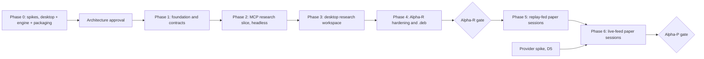

# Clipper Alpha: phased delivery and release gates

**Status:** proposed, for review under issue #1. This is a plan, not a backlog
or a commitment. Revised 2026-11-25 for the desktop-first direction and
maintainer decisions D1–D6.

**Assumptions:** one Linux reference machine (see `overview.md` §13), two
coding agents plus an independent reviewer, synthetic and user-supplied data,
and no paid data until Alpha-P stage 2. Agent hours are not engineering
throughput.

## Milestones

| Phase | Scope | Depends on | Exit gate |
|---|---|---|---|
| 0 | [Desktop validation spike](desktop-validation.md). Engine pin spike (Nautilus v2 RC inside a packaged CPython 3.13 environment). Reconcile the reviews; maintainer sign-off. | none | Spike evidence recorded (PASS / FAIL / NOT RUN), blockers decided, ADRs accepted or amended. |
| 1 | Monorepo with locked uv, npm and Cargo dependencies; CI covering lint, types, tests, licence and secret scans; domain DTOs; API and event schemas; scope model; `app.db` migrations; worker launcher on systemd; trading adapter skeleton. | Phase 0 | Fresh checkout builds; engine smoke in CI; OpenAPI client generated; no real-execution adapter anywhere in the dependency tree. |
| 2 | **MCP-first research slice (D4):** dataset import and validation, catalog, coverage, strategy registration by hash, deterministic backtest worker, results and trade log. Exposed through the MCP SDK v2, then the CLI. No UI. | Phase 1 | Claude Code and Codex run journey 1 end to end; the expected-ledger fixture passes; two parallel jobs and a cancellation work; scope-denial tests pass. |
| 3 | **Desktop research workspace:** Tauri shell with service attach, a single docked window, a chart with server-computed indicators, results, trade markers, workspace state, the MCP workspace tools, and a tray indicator. Then detachable chart windows and multi-monitor restore under XWayland. | Phase 2 (contracts), and the shell parts of Phase 0 | Journeys 2 and 3 pass; windows converge on agent changes; stale revisions are rejected; performance measured in the webview; desktop E2E through WebdriverIO or `tauri-driver`. |
| 4 | Alpha-R hardening: `.deb` with bundled runtime, upgrade and uninstall, backup and restore, local web defences, licence inventory and NOTICE, docs, known limitations. | Phase 3 | **Alpha-R gate** below. |
| 5 | **Paper sessions fed by replayed data:** session worker, journal, `flock` lease, idempotent commands, intents and approvals (desktop and CLI), Clipper limits, stop, cancel, flatten and emergency stop, plus the MCP paper tools. | Alpha-R | Kill tests pass; approval tests pass; the journal is complete and readable after an interruption. |
| 6 | **Live-feed paper sessions:** one provider adapter behind the feed boundary, staleness blocking, data badges, and recording only if the licence allows. | Phase 5, provider spike | **Alpha-P gate** below. |
| Later | Resuming paper sessions, WebAuthn approvals, strategy isolation, drawing tools, editor, optimization, screener, broader instruments, Windows, Cloud, broker paper accounts. | separate | Each gets its own ADRs and review. |

**Effort:** no schedule is given until Phase 0 reports. Phase 0 is timeboxed
at 3–6 working days for both spikes. Size Alpha-R and Alpha-P separately
from the spike results, including the risks in the register below. No public
beta or real-money date is promised.

## Workstream handoffs

- **Foundation owner:** Pydantic DTOs, OpenAPI generation, scope model and
  contract tests, before anyone else starts.
- **Trading and data:** catalog, fixtures, adapter, fee model, workers,
  journal. The UI never invents financial results.
- **MCP and CLI:** tools, host configuration and scope enforcement, and the
  first consumer of every contract.
- **Desktop:** Tauri shell, service attach, windows, packaging, and the shared
  React workspace against contract fixtures.
- **Independent reviewer:** adversarial tests and review. Never reviews their
  own code. Shared contracts change only through review.

## Alpha-R gate

- [ ] Phase 0 spike evidence reviewed; open blockers explicitly accepted or resolved.
- [ ] Clean install of the `.deb` on the reference machine. No developer toolchain is needed, the app works offline with synthetic fixtures, and upgrade and uninstall keep user data.
- [ ] The shell attaches to exactly one authenticated service. A second launch, closing the last window, a shell crash and reopening all behave as specified. Stopping the service reports the actual state. MCP and CLI work with no window open.
- [ ] MCP from Claude Code and Codex: tools are listed, import, coverage, backtest submit, status, cancel, results and trade log all work, as do the workspace read and write tools. Pagination, redaction and scope denial are tested.
- [ ] Docked workspace, then detachable charts on two monitors under XWayland. Resize, DPI and monitor-removal fallback work. Wayland limitations are documented.
- [ ] Imported fixtures validate. Timestamps, calendar, sessions, hashes and the close-stamp-to-open-display mapping are correct.
- [ ] Financial fixtures pass: fees (one shared model), precision, insufficient cash, look-ahead, split refusal, ambiguity detector warnings, and reproducible runs.
- [ ] The UI shows candles, volume, server-computed indicators, trade markers, equity, drawdown and warnings, each linked to its manifest. No mock numbers.
- [ ] Performance targets measured inside the Tauri webview on the reference GPU and driver, with the display mode recorded.
- [ ] Local web defences tested: Host and Origin checks, CSRF, token handling, CSP and Tauri capabilities. Logs are redacted.
- [ ] Licence inventory covers Python, Rust crates and npm. Lightweight Charts' NOTICE and attribution are present. Dataset entitlements are documented.
- [ ] Known limitations and the threat model (ADR-015) are published. The maintainer approves the release.

## Alpha-P gate

- [ ] Paper sessions run from a replay feed, then a live feed. No route to a real account exists in the build.
- [ ] Approvals are bound to the intent hash. Expiry, replay, tampering, cross-session use and MCP-refusal tests pass, and the red-team results are recorded (ADR-007).
- [ ] Clipper's limits (position, loss, duration, instruments, order types) are enforced, and a stale feed blocks new orders.
- [ ] Kill tests at submit, ack, fill and persist: no duplicate orders, the session ends *interrupted* with its journal intact, and no silent reset.
- [ ] Nautilus cache database backing is shown to be disabled for sandbox sessions.
- [ ] Stop, cancel, flatten (with its own authorization) and emergency stop report actual outcomes.
- [ ] Closing windows and disconnecting the agent do not stop a session.
- [ ] The provider's terms are reviewed, recording is enabled only if permitted, and CI uses no paid keys.

## Risk register

| Risk | Severity | Mitigation / decision gate |
|---|---|---|
| WebKitGTK rendering on the NVIDIA proprietary driver | High | Phase 0 test under XWayland and Wayland, with and without the DMABUF renderer. Fallback: evaluate the Tauri 3 CEF runtime, with maintainer approval. |
| Nautilus v2 RC API churn before `2.0.0` | High | Exact pin; churn confined to the adapter; fixture suite runs on every pin change. |
| Packaging Python, Nautilus and the shell into one `.deb` | High | Phase 0 packaging test on the reference machine; build on an Ubuntu 22.04 base; no frozen binary. |
| Look-ahead, intrabar and corporate-action errors | High | Independent fixtures, ambiguity detector, split refusal, price-return labelling. |
| Same-user agent bypassing approval | High (accepted for alpha, D2) | Documented threat model, MCP refusal, hash-chained audit; WebAuthn later. |
| Duplicate commands or lost journal events | High | Idempotent `command_id`, one transaction per event, `flock` lease, kill tests. |
| Secrets or licensed data in the public repository | High | Ignore rules, secret scanning, synthetic CI data. |
| Wayland window placement | Medium | XWayland default; semantic layout saved apart from native bounds. |
| Tauri 3 migration | Medium | Thin shell, few plugins, pinned 2.12.x. |
| Equity feed cost or licensing | Medium | Free data first; paid feed only in Alpha-P stage 2. |
| Windows portability debt | Medium | Platform interfaces from ADR-018; Windows spike before Windows is scheduled. |
| Overbuilding the UI or Cloud | Medium | MCP first; one docked window before detached windows; no editor, browser product or Cloud work. |

## Backlog after approval (not created yet)

Foundation and CI; trading adapter and fee models; data import and catalog;
MCP and CLI; backtesting and financial verification; desktop shell, lifecycle
and packaging; workspace and charting; paper sessions and journal; approvals
and limits; licence and security hardening. Later: resume, WebAuthn,
isolation, drawings, editor, Windows, Cloud. Each issue needs a testable gate,
its dependencies, an owner, non-goals and evidence. Create the epics only
after maintainer sign-off.
