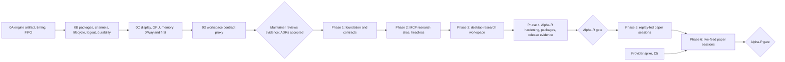

# Clipper Alpha: phased delivery and release gates

**Status:** proposed for review under issue #1. This is a plan, not a backlog
or a commitment.

**Revision 4 (2026-11-25)** addresses the Codex follow-up review and applies
D22–D26. **Acceptance rule:** the ADRs are accepted on Phase 0 evidence, not on
further document review.

**Assumptions:**
- one Linux reference machine;
- two coding agents plus an independent reviewer;
- synthetic and user-supplied data;
- no paid data until Alpha-P stage 2.

Agent hours are not engineering throughput.

## Milestones

| Phase | Scope | Depends on | Exit gate |
|---|---|---|---|
| 0 | The [validation spike](desktop-validation.md): proofs 0A–0D, each reported on its own. | none | Every check is PASS, FAIL or NOT RUN. Every FAIL is escalated and decided. ADRs accepted or amended on the evidence. |
| 1 | Monorepo with locked uv, npm and Cargo dependencies. The restricted engine build and its inspection gate in CI. CI covering lint, types, tests, licences and secret scans. DTOs, the approval envelope and the controller model. API, change-log and stream-cursor schemas. Grant model and capability matrix. Unix-socket and loopback listeners. `app.db` migrations. Worker launcher with intents and leases. Adapter skeleton with the timing mechanism chosen in 0A. | Phase 0 | Fresh checkout builds. Engine smoke tests run from the restricted wheel. Inspection gate is green. OpenAPI client generated. |
| 2 | **MCP-first research (D4).** Import from staged roots, validation, corporate-action coverage, catalog. Strategy snapshots with structural validation, plus **CLI acknowledgement**. Deterministic backtests with `after_watermark`, attribution and FIFO. Results and trade log. Exposed through MCP grants, then the CLI. | Phase 1 | Claude Code and Codex complete journey 1. Independent-ledger and counterexample fixtures pass. Invocation and denial tests pass for every grant. |
| 3 | **Desktop research workspace.** Shell over the Unix socket; one docked window; service-computed indicators; results and markers; workspace with durable cursors; MCP workspace tools; tray. Then detachable windows and restore under XWayland. | Phase 2; 0B and 0C | Journeys 2 and 3 pass. Windows converge. Stale revisions and restarts behave as specified. D26 targets met. Desktop E2E passes. |
| 4 | **Alpha-R hardening.** Side-by-side runtime packages, activation fence, prune. Upgrade while backtests are active. Uninstall. Backup and restore. Local web defences. **Release evidence**, plus the LGPL override test. Docs. | Phase 3 | **Alpha-R gate.** |
| 5 | **Replay-fed paper sessions.** Controller model and control transfer. Outbox, receipt, outcome and publication chain. Lease, terminal record and seal. Intents and approvals. Pre-trade gate. Human stop, cancel, flatten and emergency stop. MCP `paper:halt`. Logout drain with 30 s timeout and supervised shutdown. Upgrades wait for sessions. | Alpha-R | Paper fault suite, controller and logout tests, and halt tests pass. |
| 6 | **Live-feed paper sessions.** One provider. Decide where the feed client runs before credentials arrive. Staleness handling. Retention and export filter under the provider licence (D25). | Phase 5; provider spike | **Alpha-P gate.** |
| Later | Session resume; protected approval; isolation; multi-file strategies; drawings; editor; optimization; Windows; Cloud (including sessions that run independently of a login); broker paper. | separate | Each gets its own ADRs and review. |

**Effort:** no schedule until Phase 0 reports (timebox: 6–10 working days).
Alpha-R and Alpha-P are then estimated separately from the evidence. No beta
or real-money date is promised.

## Workstream handoffs

- **Foundation:** DTOs, the approval envelope, the controller model, OpenAPI,
  change-log and cursor schemas, the grant model and contract tests come
  first.
- **Trading and data:** the restricted build, adapter, timing mechanism,
  attribution, FIFO, specifications, corporate actions, workers, journal and
  sealing. The UI never invents financial results.
- **MCP and CLI:** grants, tools, host configuration, the acknowledgement
  command and the control CLI. This stream is the first consumer of every
  contract.
- **Desktop:** shell, channels, lifecycle, packages, windows and the React
  workspace.
- **Independent reviewer:** adversarial and fault tests. Never reviews their
  own code. Shared contracts change only through review.

## Alpha-R gate

**Phase 0 and engine:**
- [ ] Phase 0 evidence reviewed; every escalation decided.
- [ ] The engine artifact passes inspection: only the sandbox execution factory, with provenance (D13).

**Install and lifecycle:**
- [ ] Side-by-side runtime packages install offline. Upgrading while backtests are active keeps the old runtime and defers activation. `prerm` refuses removal while in use. Prune works. Uninstall keeps data.
- [ ] Unix-socket peer checks and relay resistance hold. The webview passes REST and stream-ticket tests on the installed package, with the actual origins recorded.
- [ ] Single instance, last-window detach, shell crash, service restart with adoption, explicit drain and reboot all behave as specified.

**MCP and desktop:**
- [ ] MCP from Claude Code and Codex: invocation and denial tests for every grant, the CLI acknowledgement step, rotation and revocation, and jobs that survive the host exiting.
- [ ] Docked workspace, then detached windows restored under XWayland. Durable-cursor streams lose nothing between snapshot and subscribe.

**Financial correctness:**
- [ ] Fixture provenance recorded (D25). Calendar, half days, DST, instrument metadata, corporate-action coverage refusal and markers placed by execution time.
- [ ] Independent ledgers pass through the packaged engine: the `after_watermark` counterexample suite, attribution, FIFO reconciliation, the order-level fee cap, effective-dated fees, lot and tick checks, insufficient cash, competing stop and target orders.

**UI, performance and release:**
- [ ] The UI shows service-computed indicators, markers, equity, drawdown and warnings, each linked to its manifest.
- [ ] D26 targets: ≥ 30 FPS sustained (target 60) and desktop memory < 1 GB under XWayland, with NautilusTrader peak reported.
- [ ] Webview least privilege; logs redacted.
- [ ] Release evidence: the LGPL override tested, including across an upgrade; source provided only as the licences require; maintainer and legal review done (D20).
- [ ] Threat model and audit-chain limits published. The maintainer approves the release.

## Alpha-P gate

- [ ] Paper sessions run from replay, then from a live feed. The artifact gate still holds.
- [ ] **Controller (D24):** one controller per session; non-controllers are read-only; explicit transfers are journalled and invalidate pending approvals.
- [ ] **Logout (D16, D24):** the controller's logout ends the session within 30 s, with orders cancelled and history preserved. Past 30 s, a supervised shutdown marks it `interrupted`. A non-controller's logout doesn't end it. Upgrades wait until sessions stop (D23).
- [ ] **Approvals:** the envelope is bound to its digest and the controller. Expiry, replay, tampering, cross-session use, non-controller and MCP refusals tested. Red-team record kept.
- [ ] **Durability:** kills at every boundary; expiry after a lost receipt; a gateway outage during commits; disk full; power loss; a crash between the journal and `app.db`. Exactly one terminal record per session, and sealed journals refuse every mutation.
- [ ] **Limits:** Clipper's limits, exposure reservation, collars as limit prices, and stale-feed blocking.
- [ ] **Stops:** the controller's stop, cancel, flatten and emergency stop; MCP `paper:halt` with `on_stop` suppressed and queued commands withdrawn. All report actual outcomes.
- [ ] **Data:** cache database backing absent. Retention and export filter follow the licence (D25). No paid keys in CI.

## Risk register

| Risk | Severity | Mitigation / decision gate |
|---|---|---|
| Restricted engine build wider than expected | High | Four-part patch, `cargo tree` gate, proposal upstream. Escalate if infeasible; D1 stays (D13). |
| Timing enforcement needs an engine hook | High | Test both mechanisms, preferring native (D22). Counterexample suite on backtest and replay. |
| Lost, duplicate or unsealed paper events | High | Outbox and receipts, one-transaction seal, stable-inode lease, fault suite. |
| Logout drain longer than 30 s | High | Bounded drain, supervised stop, `interrupted` with history preserved (D24). |
| Side-by-side packaging complexity | High | Versioned runtime packages, admission fence, `prerm` guard, two-version test (D23). |
| WebKitGTK on the NVIDIA driver; memory budget | High | XWayland-first matrix; D26 targets; escalate on failure (D17). |
| Webview origin or CSP behaviour | High | Origins recorded in 0B; shell-served CSP; fallback to a fixed port or a Rust bridge. |
| Nautilus v2 RC churn | High | Exact pin; changes confined to the adapter; fixture suite on every pin change. |
| LGPL and AGPL obligations | High | Release evidence; override test; maintainer and legal review (D20). |
| Same-user agent bypass | High (accepted for alpha, D2) | Threat model; grants; controller; audit limits disclosed. |
| Secrets or licensed data in the public repository | High | Ignore rules, secret scanning, synthetic CI data (D25). |
| Equity feed cost or licensing | Medium | Free data first; stage 2 only; export filter. |
| Windows portability debt | Medium | ADR-018 interfaces; Windows spike first. |
| Overbuilding | Medium | MCP first; proofs before polish; one docked window before detached windows. |

## Backlog after acceptance (not created yet)

**Alpha-R:**
- foundation and CI, including the restricted engine build;
- the trading adapter, timing gate, attribution, FIFO and specifications;
- data, calendars and corporate actions;
- strategy snapshots and acknowledgement;
- MCP grants and the CLI;
- backtesting and financial verification;
- shell, channels, lifecycle and side-by-side packaging;
- workspace, streams and charting;
- release evidence and security.

**Alpha-P:**
- the controller model;
- paper sessions, the outbox, the journal and sealing;
- approvals and limits;
- logout and halt.

**Later:** resume, protected approval, isolation, drawings, editor, Windows,
Cloud.

Every issue needs a testable gate, its dependencies, an owner, non-goals and
evidence.
