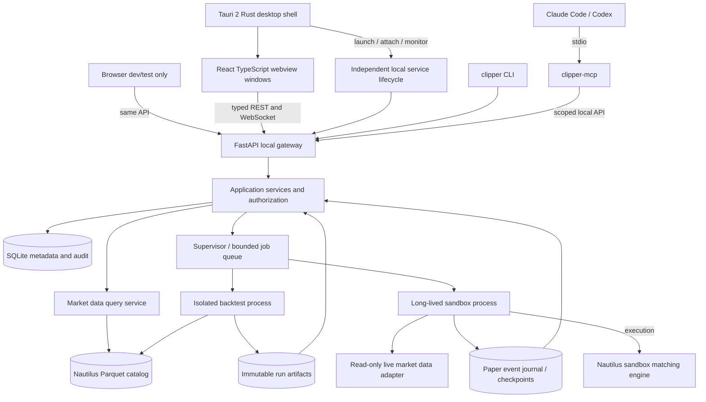
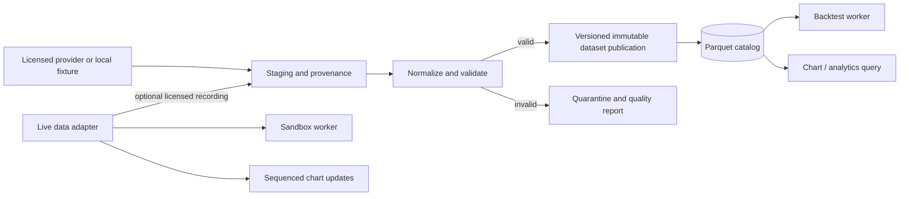
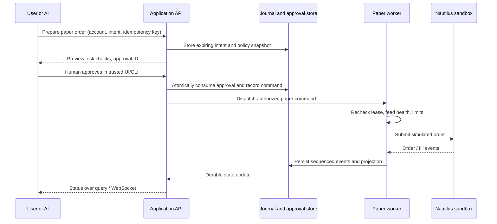

# Clipper Terminal — system design

**Status:** Proposed for independent Claude review and maintainer approval (issue #1).  
**Date:** 2026-11-25. **Product:** Whalesback Systems LLC.  
**License:** AGPL-3.0-or-later, consistent with the current README.

## 1. Product and scope

Clipper is a desktop-first, local-first, open-source, AI-controllable quantitative trading workstation: professional charting, Python strategy development, reproducible NautilusTrader backtests, and paper trading. Humans and AI agents operate the same application services. Clipper is independent of Leviathan; integration is through public APIs/MCP, never a required dependency.

Alpha 0.1 targets a single Linux x86-64 desktop user (Pop!_OS 24.04 LTS reference platform; verify actual installed environment and session), US equities/ETFs, daily and minute OHLCV for research, one validated live data provider for sandbox trading, a dockable chart workspace with a detachable-window milestone, one example strategy, manual paper orders and bounded continuous paper strategy deployment. Support synthetic fixtures and user-imported data without paid credentials. Real-money execution is absent from alpha builds, not just hidden by a toggle. No Pine compatibility, options, distributed compute, commercial data redistribution, marketplace, or cloud multi-tenancy in alpha. Broker paper accounts, tick-level strategies, shorting/margin and advanced drawings are later work; default sandbox is cash/long-only.

Primary journeys:
1. Import a dataset; select instrument, resolution and session; inspect candlesticks and coverage.
2. Register a versioned Python strategy; submit a run with dates, costs, starting capital and fill assumptions; inspect progress, fills, equity, P&L and drawdown; export evidence.
3. Connect Claude Code/Codex via local MCP; perform the same research, run, inspect and display results without opening a desktop window.
4. Create a virtual account, approve a bounded strategy deployment or order, observe live-data-driven simulated fills, stop/cancel safely and inspect account history. AI disconnect must not terminate approved worker.
5. Recover from worker interruption: show stale/unknown state, block new orders until reconciliation, and never silently reset funds.

## 2. Component topology



### Responsibilities and interfaces

- **Desktop:** Tauri 2 + Rust for native window lifecycle, launch/attach, packaging and narrowly scoped OS integration. React/TypeScript, Lightweight Charts and (pending scope review) Monaco are shared UI code. Browser mode is a dev/test harness only in Alpha 1; future Cloud can reuse the frontend. Render typed API read models; no trading logic in Rust shell or JavaScript. Chart adapters and workspace state are separate from trading state.
- **Gateway:** Python (3.13 candidate, subject to wheel/SDK validation) + FastAPI/Pydantic, REST for queries/commands, WebSocket for sequenced job, account and chart events. Local loopback by default, explicit token and origin policy; no secrets in responses. Generated OpenAPI client is the TypeScript contract.
- **Application layer:** owns identities, authorization, approval, idempotency, run manifests, job lifecycle and read-model projection. One command path for desktop, CLI and MCP (and development browser). No direct MCP access to storage, shell or engine internals.
- **MCP:** official Python SDK, stdio transport, minimal scoped API client. Only structured tools/resources, bounded result pages and job IDs. No arbitrary execution tool, credential access, or direct SQL. Remote Streamable HTTP deferred.
- **Supervisor:** bounded queue with explicit CPU/RAM/time limits, subprocess lifecycle, cancellation and restart. One Nautilus node per process. Backtests read immutable snapshots. Paper workers survive client disconnection; application owns durable lifecycle. No Redis/Celery/Kubernetes required initially.
- **Trading adapter:** owns version-specific Nautilus configuration, instrument mapping, event translation, strategy loading and engine capabilities. Do not fork or duplicate matching, order state or accounting. Treat adapter as an anti-corruption layer; domain DTOs must not depend on internal engine types.
- **Data:** canonical Nautilus catalog, SQLite for metadata and job/account/event indexes, immutable result artifacts. DuckDB/Polars for read-only analytics using supported schemas, never the execution ledger.
- **Persistence:** single application writer for metadata, worker messages with unique IDs and sequence; commit event plus projection/checkpoint atomically when feasible. SQLite WAL, busy timeout, migrations and backup tests. Never share live mutable Nautilus cache objects across processes.
- **Credentials:** provider keys stored outside repository and isolated from agents and strategy workers wherever feasible; separate read-only data credentials from any broker execution capability.

### Proposed repository layout (not existing files)

```text
apps/desktop/              Tauri 2 shell (src-tauri/ Rust)
apps/web/                  Shared React workspace and browser dev harness
src/clipper/
  domain/                  DTOs, IDs, invariants
  application/             use cases, authorization, ports
  api/                     FastAPI / WebSocket
  cli/                     clipper
  mcp/                     clipper-mcp
  market_data/             providers, catalog, quality
  trading/                 Nautilus adapter / capability matrix
  workers/                 supervisor, backtest, sandbox
  persistence/             metadata, artifacts, event journal
strategies/examples/
tests/{unit,integration,financial,e2e}/
docs/architecture/
docs/adr/
```

Repo inspection at base commit 8df267bc9d25a7a56940f5e67404bebb784d8baa: root contains .gitignore, README, CONTRIBUTING, LICENSE, LICENSES/, NOTICE, THIRD_PARTY_NOTICES and TRADEMARKS. No docs directory or application scaffold was observed. Preserve existing legal files; build scaffold only after approval.

## 3. Data design and provider boundary



Stable instrument ID includes venue/currency; symbols are display names and time-varying aliases, not primary keys. Canonical event and initialization/availability timestamps in UTC at nanosecond precision where supported; explicit exchange calendar and regular/extended session filters. Bar timestamps must declare open/close semantics; avoid use before availability. Normalize price and quantity to instrument precision; decimal strings or integer units for money and quantities at API boundaries; floats only for chart display and documented derived metrics. Preserve provider source, entitlement, timezone, resolution, adjustments, checksums, schema/adapter versions and coverage. Reject duplicates/conflicts, malformed OHLC, impossible volume, out-of-order records and unexplained gaps; distinguish closures from missing data. Corporate actions, point-in-time universe membership and delisted names are required before claiming survivorship-bias-free equity research. Do not mix adjusted fills with unadjusted execution prices. Alpha fixture can avoid corporate-action dates or explicitly model them.

Dataset manifests list exact immutable files/hashes; publish only after validation. Serialize catalog writes per partition; readers use pinned snapshots. No data redistribution or bundled proprietary feeds; BYO provider is not automatically a hosted-use license. Provider spike compares US equity coverage, history, live quote/trade entitlement, cost, symbology, rate limits and compatible Nautilus data adapter. Candidate IBKR/Databento or user CSV; no provider selected yet. Show live/delayed/stale/synthetic badge and last update everywhere relevant. Reconnect with gap detection and resnapshot; no fabricated ticks.

## 4. Execution semantics

Nautilus documents distinct backtest, sandbox and live contexts; sandbox uses simulated execution with real-time data. High-level BacktestNode loads catalog data; runtime node concurrency requires separate processes. Current latest documentation is for prerelease 2.x, while stable 1.x uses different Python APIs. Prefer an exact stable 1.x pin if required adapters and fixtures pass; run a timeboxed comparison with a pinned 2.x RC only for simulation. Choose CPython version from actual wheel/SDK compatibility, record lockfiles and CI platform; no RC for future real-money production. Do not blindly use 2.x examples against 1.x. BacktestNode and sandbox Python entry points must be validated against selected version before feature work.

**Backtest:** manifest = strategy source hash/config, engine+adapter+dependency versions, dataset hashes, instrument/calendar, date range, warm-up, initial balances, fee/slippage/fill model, seed where applicable. Results = order/fill events, positions, equity, realized/unrealized P&L, fee totals, metrics definitions, warnings and logs. Label results based on data granularity: OHLC cannot establish intrabar ordering, spread or queue position. Default reject ambiguous same-bar execution or use explicitly documented conservative assumptions. No look-ahead; order must not fill on unavailable data. Repeat fixture runs with stable ordering and compare normalized artifacts, tolerances documented. Reference fixtures independently calculate expected ledger values; no second production backtester.

**Paper:** Nautilus sandbox execution client receives market feed with no exchange order routing. Validate actual support for each order type, partial fills, fees, fill models and state recovery in the selected Python adapter. Treat fills as simulated, not evidence of live liquidity. Persist paper account ID, currency/cash, deployment configuration, order/fill journal, risk policy version, account projections and last heartbeat. One owner worker per account; no automatic restart of trading until recovery is verified. If upstream cannot restore matching state faithfully, stop and expose account as recovery-required; allow explicit archive/new account, never silently reconstruct or reset working orders. Persist enough history to audit, not claim unsupported recovery.



If dispatch outcome unknown, mark UNKNOWN, freeze conflicting commands and reconcile by stable client order ID before retry. Acknowledge acceptance separately from fill. Account states: created, ready, running, paused, degraded, recovery_required, stopped, archived; job states queued, running, cancel_requested, succeeded, failed, cancelled, interrupted. Separate stop strategy (prevent new orders), cancel working orders, and flatten positions; flatten is itself a new order and requires authorization, never promise a fill. Emergency stop blocks new orders immediately and attempts configured cancellation; report outstanding outcomes.

## 5. MCP and command contracts

Versioned REST examples: GET /v1/instruments, /v1/bars, /v1/datasets/{id}/coverage, /v1/backtests/{id}, /v1/paper/accounts/{id}; POST /v1/backtests, /v1/jobs/{id}/cancel, /v1/paper/intents, /v1/approvals/{id}/approve, /v1/paper/deployments. WebSocket event envelope: schema_version, event_id, seq, workspace_id, entity_id, type, occurred_at, payload. On sequence gap fetch fresh snapshot; cap subscriptions and event buffers. Mutations carry request ID, actor, idempotency key and expected revision; typed error codes for permission, stale, conflict, rate limit, validation and unavailable. Never return internal stack traces or secret-bearing logs.

MCP first tools: search_instruments, get_bars, get_data_coverage, list_strategies, validate_strategy, run_backtest, get_job_status, cancel_job, get_backtest_results, get_trade_log, show_backtest, open_chart, list_paper_accounts, get_positions, get_orders, prepare_paper_order, prepare_paper_deployment, stop_strategy and emergency_stop (last two scoped to explicitly granted safety capabilities). Resources expose versioned dataset/strategy/run summaries via IDs, not raw arbitrary file paths. Workspace tools also include get_workspace, list_charts, get_chart_state, set_chart_symbol, set_chart_timeframe, set_chart_indicators, get_layout and set_layout (validated schema and expected revision). Separate research:read, workspace:read and workspace:write scopes from order permissions; workspace mutations are not read-only but cannot place orders, execute code, edit risk policy, or approve orders. State is authoritative in application services, not per-window React stores. Commands target stable workspace/chart IDs; conflicting revisions return errors; desktop windows subscribe to changes and resnapshot on gaps. If no UI is running, persist workspace intent for next attach; return pending presentation rather than falsely claim a window appeared. Native window operations use a narrow shell bridge, never unrestricted MCP shell access. CLI/MCP output structured, paginated and redacted.

Research/read-only tools enabled with local token; strategy registration and backtest execution restricted to explicitly trusted/approved source and compute budgets. AI-generated Python is arbitrary code: never execute inline text in gateway/MCP; run separately under a restricted OS identity/container, no network or host secrets, read-only data/source mounts and limited output directory, resource caps, no Docker socket. If isolation unavailable, only locally trusted built-in strategies run; cloud untrusted code requires stronger tenant isolation and independent security review. Do not market sandboxed Python as safe solely because a subprocess exists.

AI order-changing actions require a human-approved, expiring, single-use intent bound to account, instrument, order, size, price constraints, policy and actor. A strategy deployment may instead receive explicit bounded standing authorization (duration, instruments, max position/notional/order rate/loss, allowed order types); worker enforces limits every order. AI cannot self-approve or change limits. Server-side enforcement independent of MCP host UI; no blanket consent. Stale feed/heartbeat or policy breach blocks new orders. Paper and real environments separated at build/config, process, credentials, storage namespace and endpoints; no real execution adapter in alpha. All actions auditable with actor, reason, policy revision, approval, request/order IDs and result. Secrets never included in logs, manifests or agent responses.

## 6. UI and interaction design

Desktop-first dark workspace inspired by professional terminals without copying proprietary assets. Top toolbar: symbol, timeframe, session, data status, run/deploy, explicit PAPER badge. Left: drawing and chart controls; center: candles, volume, overlays and trade markers; right: watchlist/instrument details and current paper account; bottom dock: strategy editor, backtest report, trade log, positions/orders, logs. Resizable dockable panels and persistent layouts; keyboard navigation and accessible focus. First vertical slice uses one native window with docked panels. Before Alpha 1 desktop completion, validate detachable chart windows on multiple monitors, independent resize and DPI, restore after relaunch and fallback to a visible monitor if disconnected. Wayland compositor controls positioning; do not promise exact placement or global hotkeys where unsupported. Persist semantic layout/chart state separately from best-effort native bounds. Native window IDs are transient; one chart state per stable chart ID. No separate backend per window. Separate research, paper and settings workspaces; paper order preview shows virtual capital, exact instrument/quantity/order type and limits, confirm in trusted UI. Always show data timestamp and environment; no use of color alone for order state. Chart uses incremental updates and pagination, cancel stale queries on symbol switches, preserve zoom on live update. Lightweight Charts is rendering foundation; custom drawing tools/indicator overlays through supported primitives, not implied built-ins. Monaco is editor, not execution sandbox.

Proposed measurable targets on documented Linux dev machine with local SSD and fixture data: cold service startup <10 s; first chart of 5k bars <2 s p95 after service ready; pan/zoom approximately 60 FPS target with 10k visible bars; cached read APIs p95 <200 ms; local event-to-UI p95 <250 ms excluding provider latency; 2 simultaneous backtests without UI starvation. Benchmarks record workload, environment and engine pin. Backtest throughput baseline measured rather than invented. All targets provisional until profiling.

## 7. Deployment and cloud boundary

Local uv/npm/Cargo lockfiles, Pop!_OS-first; Compose optional for headless/dev only, not required for desktop users; local service on loopback, trusted origin/CSRF protection where applicable, per-install API token with restricted file permissions; no public bind by default. Separate worker process identity, structured logs, heartbeat, bounded retries, status and backup/restore. Tests use synthetic data, deny real execution and external network by default. Document installation, data import, recovery and emergency stop. CI: lint/typecheck, unit tests, deterministic financial fixtures, adapter smoke, Playwright UI/MCP E2E, dependency/license/secret scans. No paid-provider keys in CI.

Future Clipper Cloud is a separate product/control plane: accounts, billing, entitlements, instance provisioning, monitoring and metering. Reuse public Clipper service interfaces; isolate each tenant's storage, secrets, workers and network. Use authenticated remote MCP with scoped tokens and server-side approvals; not a tunnel to a local token. Do not implement cloud auth or payment now. AGPL obligations and third-party notices remain, provide corresponding source where required for modified network software; independent proprietary services need legal review of actual integration boundary. TradingView attribution link/NOTICE retained. Market data agreements and regulatory review gate commercial/live launch. Current repo's copyright notice does not establish assignment of IP.

### Desktop service lifecycle and packaging

The Rust shell launches or attaches to exactly one authenticated local Python service per user/workspace profile, using an OS-owned lifecycle supervisor (evaluate Linux systemd user units versus a detached supervisor during the spike). An existing healthy compatible service is reused; never trust an arbitrary listening port. Use a restricted runtime directory, single-instance lock, authenticated version/health handshake, and bounded startup with actionable logs. Native shell owns windows, not engine or strategy processes. Closing a window never cancels trading or jobs; closing the last window defaults to detach if jobs or paper sessions are active, with visible status and a separate explicit stop-service action that reports outstanding orders and worker state. If idle, explicit shutdown is allowed. Reopen attaches and resynchronizes; forced shell crash must not stop an approved paper worker. OS logout/reboot continuity is not assumed. Headless CLI/MCP can start/attach independently. No auto-resume of uncertain paper execution.

Bundle one installable Linux artifact for the reference system (prefer .deb candidate; AppImage optional after testing). Compare installed pinned Python runtime/venv plus service launcher with Tauri external binary bundling; native Nautilus wheel, glibc/WebKitGTK dependencies, upgrade/uninstall and LGPL replaceability must be verified. Never install arbitrary packages from the network at application launch. Restrict native Tauri commands/capabilities to enumerated operations, local bundled assets, CSP, no wildcard shell/filesystem access or untrusted remote navigation. Prefer a narrow Rust credential/session bootstrap or typed proxy with no arbitrary URL/method; validate loopback Host/Origin, no wildcard CORS, protect against CSRF and DNS rebinding. Distinct MCP scopes cannot approve orders. A desktop shell does not prove human presence or isolate a same-user shell agent; independent Claude findings on approval and isolation remain blockers for paper acceptance. Keep the browser dev harness equally scoped and never expose production secrets to frontend bundles. See the validation spike for evidence required before plan approval.

## 8. Evidence and limitations

Documentation reviewed 2026-11-25, including [Tauri sidecar packaging](https://tauri.app/develop/sidecar/), [prerequisites](https://v2.tauri.app/start/prerequisites/) and [capabilities](https://v2.tauri.app/security/capabilities/); no software installed or runtime tests executed in this design issue. Exact pins and provider capabilities remain spike deliverables, not claims of working integration.
- [Nautilus overview](https://nautilustrader.io/docs/latest/concepts/overview/) — context separation.
- [Nautilus installation](https://nautilustrader.io/docs/latest/getting_started/installation/) — 1.x/2.x API and wheel distinctions.
- [Backtesting](https://nautilustrader.io/docs/latest/concepts/backtesting/), [getting started](https://nautilustrader.io/docs/latest/getting_started/), [catalog](https://nautilustrader.io/docs/latest/concepts/data/catalog/) — high-level API, process isolation and storage.
- [Sandbox adapter](https://nautilustrader.io/docs/rust-api-latest/nautilus_sandbox/index.html) — simulated execution; Python integration requires pin-specific test.
- [Adapters](https://nautilustrader.io/docs/latest/concepts/adapters/) and [live trading](https://nautilustrader.io/docs/latest/concepts/live/) — capabilities and recovery limitations.
- [Official MCP Python SDK](https://github.com/modelcontextprotocol/python-sdk) — stdio, structured tools, resources and future HTTP; pin SDK and test actual hosts.
- [Lightweight Charts docs](https://tradingview.github.io/lightweight-charts/docs), [plugins](https://tradingview.github.io/lightweight-charts/docs/plugins/intro) — rendering primitives and attribution.

See [desktop validation spike](desktop-validation.md), [ADRs](../adr/0001-alpha-architecture-decisions.md) and [implementation plan](implementation-plan.md). Independent Claude critique exists on this branch; its non-desktop findings remain open for reconciliation. Desktop-first direction supersedes the earlier browser-first suggestion (PR #2 maintainer comment). The license remains AGPL-3.0-or-later pending explicit maintainer confirmation of license and contributor/CLA policy; no license files changed. The packaging/lifecycle spike and maintainer approval remain mandatory before committing to the implementation plan and full backlog.
