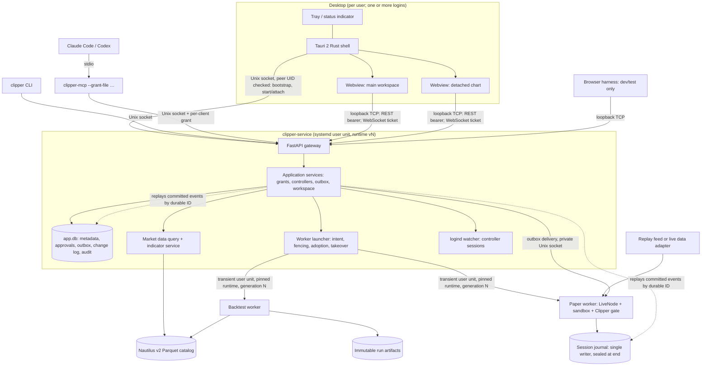
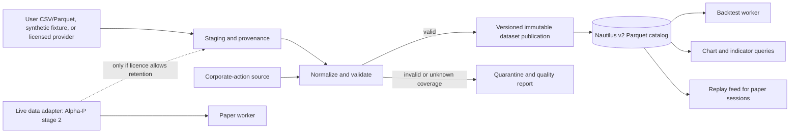

# Clipper Terminal: system design

**Status:** Proposed, not approved.

- **Revision 4 (2026-11-25)** fixes the [Codex follow-up review](codex-review-2.md)
  and applies maintainer decisions D22–D26.
- Earlier revisions folded in the [Codex review](codex-review.md), both Claude
  reviews and D1–D21.
- All of D1–D26 in [`maintainer-decisions.md`](maintainer-decisions.md) apply.
- **Sign-off rule:** the remaining risks need runtime evidence, so the ADRs are
  accepted on Phase 0 evidence, not on further document review.

**Product:** Whalesback Systems LLC. **License:** AGPL-3.0-or-later (D3).

## 1. Product and scope

Clipper is a desktop-first, local-first, open-source quantitative trading
workstation that AI agents control through MCP (D8). It provides professional
charting, Python strategy development, reproducible NautilusTrader backtests
and paper trading. Humans and AI agents use the same application services.
Clipper works with external AI orchestration tools only through its public
APIs and MCP, and never depends on one (D21).

**Platforms:**
- **Linux desktop first.** The reference is Pop!_OS 24.04 LTS on x86-64 (§13).
- **Windows later.** Nothing in alpha may rule it out (§11).
- **macOS** is not planned.

**Alpha milestones (D4):**

- **Alpha-R (research).** MCP comes first.
  - An agent imports data, checks coverage and registers strategies.
  - A human acknowledges each strategy through the CLI.
  - The agent runs deterministic backtests and reads the results and trade
    logs over MCP.
  - Then comes a CLI on the same services, then a native desktop workspace.
  - Everything runs on synthetic fixtures and user-imported data, with no paid
    credentials.
- **Alpha-P (paper).** Local paper sessions (D1, D16, D24).
  - Sessions run first from replayed catalog data, then from one live
    market-data feed.
  - Each session has one controller, human approval for orders, and a durable
    trade journal.
  - Stop, cancel, emergency stop and an MCP halt are available.

**Out of scope for alpha:**
- real-money trading (artifact gate, §7);
- resuming a paper session after it ends (D1);
- strong authorization against a same-user agent (D2);
- Pine compatibility, options, shorting and margin;
- tick-level strategies;
- advanced drawing tools;
- an in-app editor (D9);
- distributed compute;
- a browser product;
- data redistribution;
- a marketplace;
- Cloud and multi-tenancy.

**Primary journeys:**
1. *(Alpha-R, MCP)* Import a dataset and check its coverage. Register a
   strategy as a snapshot, and the human runs `clipper strategy approve <id>`.
   Then run a backtest and read the results and trade log. No window is
   needed.
2. *(Alpha-R, desktop)* Pick an instrument, resolution and session, and
   inspect the candles and coverage. Run the same backtest and review fills,
   equity, P&L, drawdown and warnings, then export the evidence.
3. *(Alpha-R, desktop and AI)* The agent inspects the open charts and layout,
   and changes symbol, timeframe and indicators. Every window converges on the
   result.
4. *(Alpha-P)* The user starts a paper session and becomes its controller. They
   approve an order or a bounded deployment, watch simulated fills, and stop or
   cancel. Other windows, and other logins of the same user, can watch the
   session. Control moves only by an explicit transfer.
5. *(Alpha-P)* **How a session ends:**
   - The controller's logout ends it: open orders are cancelled within 30 s and
     the history is preserved. If that runs long, a supervised shutdown marks
     the session `interrupted` (D24).
   - A worker crash or a reboot ends it as `interrupted`.
   - A service restart without an upgrade does **not** end it: the worker is
     adopted.
   - A runtime upgrade activates only once sessions have stopped (D23).

   Every ending writes exactly one terminal record and leaves the journal
   sealed and readable.

## 2. Runtime and language ownership

| Layer | Language / runtime | Owns | Must not own |
|---|---|---|---|
| Desktop shell | Rust, Tauri 2 (`tauri` 2.12.x) | Native windows; starting and attaching to the service over a Unix socket; single instance; tray; serving bundled assets with CSP | Trading logic, strategy execution, worker control |
| UI | React + TypeScript in the webview (WebKitGTK on Linux; WebView2 on Windows later) | Rendering typed read models, Lightweight Charts, docking, approval and control-transfer screens | State of record, financial calculations, indicator values of record |
| Local service | Python 3.13, FastAPI, Pydantic | Application services, grants, controllers, approvals, the outbox, workspace state, MCP, CLI, job and session lifecycle | Window management |
| Engine | NautilusTrader v2 (Rust core with a PyO3 Python API) in worker processes, as a simulation-only build (D13) | Matching for backtests and the sandbox, order state, portfolio | Anything outside its own worker |

Rust appears only in the shell and inside NautilusTrader's own core. No
Nautilus crates are linked into the shell (§12).

## 3. Component topology



### Responsibilities

- **Shell (Rust/Tauri):**
  - Talks to the service over a **Unix domain socket** in a `0700` runtime
    directory. The service checks the peer UID with `SO_PEERCRED`.
  - Over that socket it obtains the service's loopback port, epoch and a
    short-lived webview bearer.
  - It serves the bundled assets itself, with a CSP that names the current
    port (§4).
  - It exposes only enumerated commands, declared through
    `AppManifest::commands`.
  - It never spawns the service as a child, and never signals workers.
- **UI:**
  - One shared codebase for every window. Each window has its own JS context,
    so no state of record lives in React.
  - Windows render read models and subscribe through the durable-cursor stream
    contract (§8).
- **Gateway and application layer:**
  - One command path for the shell, CLI, MCP and the dev browser.
  - Owns grants and server-derived principals, **session controllers** (§7),
    approvals, the outbox, strategy snapshots, run manifests, job and session
    lifecycle, workspace state (§5) and the change log.
- **Indicator service:** indicator series are computed in the service, so the
  chart and the agent see identical values.
- **Worker launcher:**
  - One node per process.
  - Before starting a worker, it records a **launch intent** (session,
    generation, unit name, pinned runtime version) and marks it `starting`.
  - It fences, adopts and takes over workers (§7).
  - Workers run as transient systemd user units with cgroup limits, behind
    interfaces that a future Windows supervisor can implement (§11).
- **logind watcher:** follows the login session of each paper session's
  controller (§4, D24).
- **Trading adapter:**
  - An anti-corruption layer over the pinned engine.
  - Holds the timing enforcement (§7), the feed-event attribution actor, the
    FIFO lot projection, the Clipper pre-trade gate and the capability matrix.
  - Results come from a typed event projection. No pandas.
- **Data:**
  - The v2 catalog is the canonical historical store.
  - `app.db` (WAL, `synchronous=FULL` on every connection) has one writer, the
    gateway.
  - Each session has one journal (WAL, `FULL`) with one writer at a time.
  - Artifacts are immutable.
  - No DuckDB or Polars.
- **Credentials:**
  - Provider keys and grant tokens live in `0600` files in the user's config
    directory.
  - They never appear in process arguments, host MCP configuration, URLs,
    logs, manifests, agent output or telemetry.
  - Any same-user process can read them in alpha (D2, §9).

### Repository layout (proposed, not yet created)

```text
apps/desktop/              Tauri 2 shell (src-tauri/ Rust), asset protocol + CSP, packaging
apps/web/                  Shared React workspace; browser dev harness
src/clipper/
  domain/                  DTOs, IDs, invariants, approval envelope, controller model
  application/             grants, controllers, outbox, change log, workspace, use cases
  api/                     Unix-socket and loopback listeners, REST, stream tickets, WebSocket
  cli/  mcp/               clipper, clipper-mcp
  market_data/             import, validation, catalog, calendars, corporate actions, indicators
  trading/                 engine adapter, timing gate, attribution, FIFO lots, specs, pre-trade gate
  strategies/              snapshot store, structural validation
  workers/                 launcher (systemd now, Windows later), logind watcher, backtest, paper
  persistence/             app.db, journals, sealing, artifacts, backup, export filter
packaging/                 restricted engine build, runtime packages, shell package, units
strategies/examples/
tests/{unit,integration,financial,fault,e2e}/
docs/architecture/  docs/adr/
```

## 4. Desktop shell, service lifecycle and packaging

**No sidecars.** `tauri-plugin-shell` kills every tracked child on
`RunEvent::Exit`, so the shell does not use it.

**Identity and channels.** This replaces revision 3's HMAC challenge, which
Codex showed a relaying listener could pass.

- **Native clients** (shell, CLI and MCP) reach the service only through
  `$XDG_RUNTIME_DIR/clipper/service.sock`, inside a `0700` directory. The
  service checks the peer UID with `SO_PEERCRED`.
  - The socket path is private, so no other user can stand between client and
    service.
  - No reusable credential ever crosses loopback TCP from a native client.
- **The webview** cannot use a Unix socket, so it talks over loopback TCP:
  - The shell learns the TCP port from the service **over the authenticated
    socket**.
  - The service holds that port and never sets `SO_REUSEPORT`, so no other
    process can bind it while the service runs.
  - On restart the port and epoch change. The shell re-learns them and
    reloads its windows.
  - A same-user process could still interfere. That stays within the accepted
    threat model (D2).
- **Tests:** a relaying listener, a stale socket, a wrong-UID peer, and a
  wrong-version service.

**Lifecycle on Linux:**
- **Install.** `clipper.service` is a systemd user unit. The shell, CLI and
  MCP start it through the user service manager, from native code.
- **Single instance.** One shell per login, enforced by
  `tauri-plugin-single-instance`, which uses session D-Bus. One service per
  user, enforced by the unit and a socket lock.
- **Windows and the tray.** Closing windows never stops work. Closing the last
  window detaches the shell when something is active, and the tray stays
  visible.
- **"Stop service".** The shell asks for native confirmation, then calls the
  service's drain over the socket. The service admits no new work, cancels
  backtests, ends paper sessions through their end procedure, and reports the
  outcome before exiting.
- **Service restart without an upgrade.** Workers keep running. The service
  adopts each one by its launch intent: it checks the unit's `InvocationID`,
  that the lease is held, and the worker's generation over its socket.
- **Upgrade (D23).** Runtimes install side by side (see Packaging). A new
  runtime **activates** only once no paper session or job is using the active
  one. Until then the service, workers and launchers keep the pinned runtime.
- **Logout of the controller's login (D24).**
  1. The logind watcher sees the controller's login session enter `closing`,
     or be removed.
  2. It starts the session's **graceful end**, with a 30-second budget.
  3. The worker runs a bounded drain over IPC: close admission, suspend the
     strategy and any deferred submissions, cancel working orders, process
     execution events until each cancel resolves, write the `logout` terminal
     record and seal the journal.
  4. **After 30 s**, the supervisor stops the unit (`TimeoutStopSec=30`, then
     `SIGKILL`) and performs **terminal takeover**. That records `interrupted`
     with reason `logout_timeout`, and keeps everything already committed.

  The worker unit's `ExecStop` triggers the same idempotent drain. That covers
  a user manager that stops at the last logout when lingering is off. The
  drain does not depend on the gateway being available.
- **Other logouts.** Logging out of a login that is not the controller does
  not end the session. Paper workers start only while the requesting login is
  active.
- **Reboot or power loss.** The session ends as `interrupted`, and takeover
  runs on the next start. logind's shutdown delay inhibitors are short
  (`InhibitDelayMaxSec`), so Clipper promises no orderly cancel on reboot.
- **Signals** are used only by the supervisor: `SIGTERM` runs the `ExecStop`
  drain, and `SIGKILL` follows after the timeout. Normal control always goes
  through IPC.

**Packaging (D11, D23): side-by-side Debian packages.**
- **`clipper-runtime-<version>`.** One package per release, under a
  version-specific name, the way kernel packages are versioned. It contains
  `/opt/clipper/<version>/`:
  - a standalone CPython 3.13;
  - an environment **built at that final path** from locked, non-editable
    wheels, including the simulation-only engine;
  - the service code.

  dpkg treats each version as a different package, so installing a new one
  never removes an old one.
- **`clipper`.** The shell, the launchers and the units. It depends on the
  matching runtime package.
- **Activation.**
  - The service writes the active runtime to a state file, under an
    **admission fence**: no new session or job starts while it switches. The
    switch happens only when nothing is running.
  - Launchers and units resolve the runtime through that state file.
  - Each started worker's unit names its runtime by **absolute path**.
  - The service runs a user `daemon-reload` when it activates a new runtime.
- **Cleanup.**
  - `clipper runtime prune` removes runtimes that no process uses, checked by
    scanning for processes that map the prefix.
  - A runtime package's `prerm` refuses removal while its prefix is in use.
- **Verification.** On the reference install, check the interpreter symlink,
  `pyvenv.cfg`, `sys.executable` and `sys.base_prefix` for every launcher and
  worker. Also check native imports and ELF dependencies, and grep for leftover
  build paths. Build on Ubuntu 22.04.
- **Runtime behaviour.** Nothing is downloaded at launch, and all paths are
  absolute.
- **Other formats.** AppImage and Flatpak are deferred.

**Webview security:**
- **Commands.** Declared through `AppManifest::commands`, with
  least-privilege capabilities per window. Capabilities are additive, so tests
  check that a detached window is denied the main window's commands.
- **Navigation.** `on_navigation` allows only bundled content, and
  `on_new_window` denies everything.
- **CSP.**
  - The shell serves the bundled assets through its own protocol handler and
    sets a CSP header naming the current port. `connect-src` lists
    `http://127.0.0.1:<port>` and `ws://127.0.0.1:<port>` separately.
  - The header has to arrive before web content loads. The spike confirms
    that, or selects the fallback: a fixed per-user port.
- **REST.** Uses a short-lived webview bearer, obtained by the shell and
  rotated on attach. It is never put in a URL or the bundle.
- **WebSocket.** The client offers the subprotocols `clipper.v1` and
  `ticket.<base64url>`. The ticket is single-use, comes from
  `POST /v1/stream-tickets`, and is bound to the instance, epoch, scopes,
  subscription authority and origin, with 30 s expiry.
  - The server consumes the ticket atomically **before** the upgrade, after
    checking Origin, Host, epoch, expiry and scopes.
  - It selects only `clipper.v1` and redacts the header from logs.
  - Revoking or rotating a grant closes any stream that grant opened.
- **Origin and Host.**
  - Webview bearers require the exact webview origin. Linux uses
    `tauri://localhost`; Windows will use `http://tauri.localhost`. The spike
    records the actual values.
  - Native clients don't use TCP.
  - If WebKitGTK sends an opaque origin, the webview moves to a narrow Rust
    bridge.
  - The `Host` header is validated, and CORS never uses a wildcard.

**Display server (D7, D17):**
- **XWayland first.** XWayland (`GDK_BACKEND=x11`) is the priority mode, and
  detached-window restore must work there.
- **Escalation.** If XWayland fails, escalate to the maintainer. Native Wayland
  runs in the matrix only as a diagnostic. CEF is evaluated only at the
  maintainer's direction.
- **Window placement.** Clipper adds its own fallback to a visible display on
  top of `tauri-plugin-window-state`.
- **Measurement.** Targets are measured inside the webview on the reference
  NVIDIA GPU (§10).

**Version policy.** Tauri is pinned to 2.12.x, and the shell stays thin. §14
keeps candidate versions apart from tested selections.

## 5. Workspace state and AI desktop control

MCP is the primary AI control interface (D8). Every capability an agent needs
is an MCP tool, except human approvals, control transfer, policy and native
window operations. UI automation is not a supported path.

**Authoritative state:**
- The workspace lives in the service, in `app.db`. It holds layouts (the dock
  tree and detached-window assignments) and charts (instrument, resolution,
  session, indicator specs, overlays).
- Every entity has a revision, and each change is appended to the change log
  (§8).
- Native window IDs are transient; chart IDs are stable.

**Workspace tools:**
- `get_workspace`, `list_charts`, `get_chart_state`, `open_chart`,
  `set_chart_symbol`, `set_chart_timeframe`, `set_chart_indicators`,
  `get_layout`, `set_layout` and `show_backtest`.
- Each mutation carries the expected revision. A stale one returns `conflict`.
- With no window open, a mutation returns `presentation: "pending"`.
- The viewport is a best-effort, throttled hint, not state of record.

## 6. Data design and provider boundary



**Free data first (D5).** Fixtures and user CSV or Parquet are first-class and
are the CI default. Databento is the leading candidate for stage 2. The
provider spike compares cost, coverage, entitlements, licence terms (local use,
export, retention), corporate-action coverage, symbology and rate limits. It
also checks that bars match live quotes and trades. Every source gets a
terms-of-service check. Clipper never scrapes, and ships no credentials or
licensed data.

**Correctness rules:**
- **Instruments.** Instrument IDs are stable and include venue and currency.
  Symbols are aliases. Instrument metadata (price increment, lot size, minimum
  quantity, listing and delisting) is versioned and pinned per manifest.
- **Time.**
  - Each event keeps separate UTC values for event identity, availability
    (`ts_init`), decision, submission and execution. Chart labels are derived,
    never stored as truth.
  - The calendar version is pinned, including half days and DST.
  - Warm-up cutoffs are explicit.
- **Bars and markers.**
  - The catalog stores bars stamped at their close, because Nautilus needs
    `ts_init` at the close.
  - Charts plot bars at their open, in exchange-local display time. A DST
    fixture covers the shifted-time ordering hazard.
  - Markers are placed by **execution time**. Each fill carries an attribution
    record (§7).
- **Precision and ticks.**
  - Prices are stored to 4 decimal places. That is representational only.
  - Order prices are validated against the increment rules in force on the
    data date (Rule 612, amended with a November 2027 compliance date).
  - Quantities are validated against lot size and minimum quantity.
  - Money crosses the API as decimal strings.
- **Validation.** Reject duplicates, conflicts, malformed OHLC, impossible
  volume, out-of-order records and unexplained gaps.
- **Corporate actions (D14), fail closed.**
  - Prices are unadjusted.
  - Each dataset declares its **corporate-action source and coverage**.
  - A run is refused if a known split falls in range, **or if coverage for the
    traded instrument and range is unknown**. Synthetic fixtures declare that
    they have no actions.
  - Returns are price-only. There are no total-return benchmarks.
- **Phase 0 fixtures (D25).** Phase 0 uses synthetic data: OHLCV bars plus
  bid/ask quotes, with full provenance (generator, seed, version and declared
  corporate-action coverage). The quotes exercise first-eligible-event matching
  (§7).
- **Manifests.** Each manifest lists exact files and hashes, and reads are
  limited to them.
- **Retention and export (D19, D25).**
  - **Local retention.** The journal always stores feed identity, sequence and
    timestamps. Market data is stored or exported only where the licence
    allows. Otherwise it is withheld and flagged (`driving_data_retained=false`,
    or the export field marked withheld).
  - **Export.** An **approved export** is built from an online-backup
    snapshot and then passed through an **export filter**. The filter removes
    provider-restricted fields, including derived fields and feed metadata the
    licence restricts.
  - **Recovery copy.** A raw backup is for local recovery only.
  - The provider spike records each provider's retention and export rules.
- **Data status.** Every view of data shows its badge and last update time.
  Gaps cause a resnapshot, and ticks are never fabricated.

## 7. Execution semantics

### Engine pin and artifact gate (ADR-002, D1, D13)

**Pin:** NautilusTrader v2 (`2.0.0rc9` today) on CPython 3.13. The move to
`2.0.0` final goes through one PR that runs the full fixture suite.

**Simulation-only build (D13).** The ordinary rc9 wheel imports Binance and
Interactive Brokers execution factories. A feature-list change alone is
**not enough**, as Codex showed. The build is made from the exact upstream tag
with an auditable patch that:

1. **Replaces the default `adapters` umbrella** in `crates/pyo3/Cargo.toml`
   with Clipper-selected per-adapter features, enabling only
   `nautilus-sandbox` and `nautilus-databento`.
2. **Changes the native registration guards** in `crates/pyo3/src/lib.rs` from
   `#[cfg(feature = "adapters")]` to the per-adapter features, so the two kept
   adapters still register.
3. **Removes the unwanted maturin features** from `python/pyproject.toml`:
   `defi` and `hypersync`, which pull in the blockchain adapter. It also
   removes `redis` and `postgres`, which **natively enforces** the ban on cache
   database backing for sandbox sessions, if the build still passes without
   them.
4. **Prunes the staged Python tree** of the excluded adapter packages, and
   regenerates or prunes `adapters/__init__.pyi` and any feature-dependent
   stubs.

**Gate:**
- `cargo tree -p nautilus-pyo3 -e features`, run with the wheel's own flags,
  shows only the intended features. Weak forwarding and transitive edges are
  included.
- The wheel manifest and native modules show no excluded adapter. The only
  importable execution factory is the sandbox's, and Databento imports.
- Clean-install backtest and sandbox smoke tests pass.
- Provenance is recorded: tag, patch, toolchain, checksums. Source is provided
  as the LGPL requires (D20).

Clipper also proposes per-adapter features upstream. If the build proves
infeasible, escalate to the maintainer; relaxing D1 is not a fallback.

### Backtests

**Manifest:**
- the strategy snapshot hash and the **canonical strategy configuration**
  (normalized JSON and its hash);
- named immutable inputs;
- engine build ID (shipped or override, §12), adapter and dependency versions;
- dataset files and hashes;
- instrument metadata, calendar and corporate-action source versions, with
  coverage;
- date range, warm-up and initial balances;
- fill, fee and latency specification versions;
- the timing policy and enforcement mechanism (D22);
- the seed.

**Results:**
- order and fill events, each with its **attribution record**;
- positions, the **FIFO lot projection**, equity, and realized and unrealized
  P&L;
- fee totals;
- metric formulas;
- warnings and logs.

**Venue configuration:** always pinned to `account_type=CASH`,
`default_leverage=1` and an explicit `oms_type`. The backtest exchange would
otherwise default margin accounts to 10×; the sandbox defaults to 1×.

**Execution timing (D14, D22).**

The policy is **`after_watermark`**: an order may match only against a book
update derived from a **new feed event for its own instrument**, where
`ts_init` is greater than the decision's data watermark.

Codex showed that latency alone does not guarantee this on stock rc9:
- A strategy timer released an order at 00:01:02 at the observed close,
  1.10010.
- The end-of-run drain released one at 00:01:01.
- The sandbox drains due commands before applying each update.

Phase 0 tests two mechanisms and prefers the first:
- **(a) Native.** An upstream-supported configuration that passes the whole
  counterexample suite. For example: no time alerts in alpha strategies, the
  end of the feed turning pending commands into `unfilled_end_of_data`, and
  latency set against the data cadence. An upstream next-event settlement mode,
  if contributed and released, also counts as native.
- **(b) Clipper gate.** A narrow eligibility check on the matching path, in
  both backtest and paper. Commands released by timers, drains or another
  instrument's data stay queued until an eligible event arrives.

**Counterexample suite:**
- timers;
- the end of the feed;
- equal timestamps;
- data for an unrelated instrument;
- ordering of the first update;
- a stale feed;
- resting orders;
- partial fills.

`signal_close` remains an explicitly labelled option.

**Attribution and FIFO:**
- **Attribution.** rc9 fills carry a simulator `trade_id` but no reference to
  the input feed record. A Clipper actor observes data and order events in
  dispatch order and records, for each fill:
  - the last applied feed event ID for the instrument;
  - the synthetic OHLC leg, if the fill came from a bar;
  - or an explicit `origin` value (`timer`, `command`, `end_of_data`) when no
    eligible feed event preceded it.
- **FIFO cost basis.** rc9 allocates cost proportionally. Clipper keeps a
  **separate FIFO lot projection**, which is the record of truth (D14).
  Quantities and cash must reconcile exactly with the engine. Differences in
  P&L method are reported, not hidden.
  - Fixture: buy 1 @ 10 and 1 @ 20, then sell 1 @ 30. FIFO gives 20; the
    engine's method gives 15.

**Intrabar ambiguity:** Clipper uses `bar_adaptive_high_low_ordering`, and a
detector flags bars where a stop and a target compete within one bar.

**Fees:**
- A versioned broker fee specification (D14), with fixture values from a
  published broker schedule.
- A per-share commission, with an **order-level minimum and cap across
  fills**.
- Explicit rounding.
- Section 31 fees by effective date. FINRA TAF as a separate line.
- Each process instantiates the same specification version.

**Verification:**
- **Independent ledgers** run through the **packaged** backtest and the replay
  sandbox. They cover:
  - callback timing;
  - partial fills;
  - FIFO, with multiple entry prices and a partial exit;
  - lot and tick refusal;
  - insufficient cash;
  - competing stop and target orders;
  - split and unknown-coverage refusal;
  - half days and DST.
- Repeatability is necessary, not sufficient.
- **Known gaps:** no T+1 settlement, good-faith violations, pattern-day-trader
  rules or borrow.

### Paper sessions (D1, D16, D18, D24)

**Engine:**
- The v2 sandbox (in-memory `SandboxMatchingEngine`) with the same
  specifications and timing enforcement as backtests.
- It seeds balances only, and its fill and position reports are empty, so
  restart recovery is impossible.
- Cache database backing is forbidden. Removing the `redis` and `postgres`
  features enforces that natively where feasible.

**Controller (D24):**
- **Who controls.** Each session has exactly one controller: a human principal
  bound to a **logind session ID** and a client. Only the controller's
  surfaces (desktop or CLI in that login) may approve, cancel, flatten,
  re-enable, stop or end the session. Other windows and logins are read-only.
- **Transfer.** Control moves in one of two ways:
  - *release:* the controller hands control over;
  - *take:* a human in another login explicitly takes control, with
    confirmation. The current controller is notified.

  Either way, a `control_transferred` event goes to the journal with both
  principals, both login sessions and the reason. Approvals still pending
  under the previous controller are invalidated.
- **Lifetime.** The session's lifetime follows the controller's login session.
- **MCP.** MCP principals can never be controllers. MCP halt (D15) does not
  require control.

**Durability chain.** Each step's result is published only after it commits:

1. **Authorize and enqueue.** One `app.db` transaction consumes the approval,
   checking that it came from the current controller. It inserts an outbox row
   with `command_id`, session, generation, intent digest, policy revision,
   approval ID, actor, reason and dispatch expiry.
2. **Deliver.** The gateway delivers rows over the session's private socket
   and retries with the same ID.
   - **Expiry** stops new delivery attempts. It never turns "lost
     acknowledgement" into "undelivered".
   - Before marking a command `expired_undelivered`, the gateway asks the
     worker, or reads the journal under the lease, whether a receipt exists.
     A receipted ID is always a lookup, even after expiry.
3. **Admit and receipt.** At first admission the worker checks ID,
   generation, payload digest, expiry and authorization. It then commits a
   **receipt** (`UNIQUE(command_id)`, digest) **with the approval binding**
   (approval ID, actor, reason, digest), so exports include it.
   - The same ID and digest return the existing receipt.
   - A changed digest returns `conflict`.
   - An expired admission is refused and journalled as `refused_expired`.
   - Policy is rechecked and exposure reserved. Collars become limit prices.
   - Lot and tick rules are enforced.
4. **Outcome.** Each engine response is committed with its projection, the
   resulting cash and position changes, and the attribution record, all in
   one transaction.
   - Per-command progress goes `received`, then `refused` / `accepted` /
     `rejected`, then `partially_filled`, then `filled` / `cancelled`. Each
     receipt names its **resolving event**.
   - `ClientOrderId` derives from `command_id`.
5. **Publish.** The UI shows *received*, *venue response* and *filled* only
   after commit (D18).
   - The gateway keeps a durable last-published event ID per journal.
   - After a gateway outage, it replays committed events from the journal,
     including commits made while it was down.

**Lease and fencing:**
- **The lease file.** `sessions/<id>.lock` is created **once, at session
  creation**, and never replaced, so its inode stays stable. It is opened
  with `O_CLOEXEC`. Workers spawn no children with inherited descriptors
  (`close_fds`, `pass_fds=()`).
- **Locking the journal.** The journal file is created with the session,
  before launch.
- **Launch-intent states.** `starting` (unit requested, lease not yet taken),
  `running` (lease held, generation written to the journal), `ended`.
- **Takeover rules.** Takeover requires all three:
  - the unit is inactive, by systemd state and `InvocationID`;
  - the lease can be acquired;
  - the journal's last generation matches the intent.

  An intent stuck in `starting` with no journal generation is resolved by
  stopping the unit, then taking over.

**Terminal record and seal (single transaction):**
- **One transaction.** The terminal record and the **seal row** are written
  together, under the lease, with a `UNIQUE` terminal key. That gives exactly
  one terminal record per session.
- **Clean end.** The worker writes it: `stopped`, `drained` or `logout`, after
  cancelling working orders and processing events until each cancel resolves
  (D16, D24).
- **Takeover.** The service writes it: `interrupted`, with the reason, the
  last durable event and any unresolved receipts.
- **Sealing triggers.** `BEFORE INSERT`, `UPDATE` and `DELETE` triggers on
  **every** ledger table, including the seal row, abort once the seal exists.
- **Repair.** After a restart, the service idempotently repairs its own status
  and copied head in `app.db`.
- **Disk full.** The journal keeps a reserved block (a pre-allocated
  placeholder released for the terminal write). If takeover still cannot
  write, the session stays fenced as `finalization_pending`, and Clipper never
  reports a terminal state before its commit.
- **Write failure while running.** The worker freezes: it suspends the
  strategy, refuses commands and attempts the terminal write.

**Journal contents:**
- ordered event IDs;
- feed identity and sequence;
- the approval bindings;
- control transfers;
- policy and specification revisions;
- effective and observed timestamps;
- attribution records;
- the cash and position changes;
- `driving_data_retained`;
- the hash-linked audit chain.

**States.** Sessions are `ready`, `running`, `ending`, `ended` (with reason),
`finalization_pending` and `archived`. Jobs are `queued`, `running`,
`succeeded`, `failed`, `cancelled` and `interrupted`. Resume after an end is
deferred (D1).

```mermaid
sequenceDiagram
  participant U as User or AI (MCP)
  participant A as Clipper service (app.db)
  participant H as Controller (desktop/CLI)
  participant W as Paper worker (gen N)
  participant J as Session journal
  participant N as Nautilus sandbox + timing gate
  U->>A: prepare_paper_order(session, intent)
  A-->>U: Preview, approval ID (pending)
  H->>A: Approve digest (controller only; MCP refused)
  A->>A: One txn: consume approval + outbox row
  A->>W: Deliver(command_id) and retry the same ID
  W->>J: Commit receipt + approval binding
  W-->>A: Receipt
  W->>N: Submit limit order (ClientOrderId from command_id)
  N-->>W: Venue response / fill on an eligible feed event
  W->>J: Commit event + projection + cash/position + attribution
  A->>J: Replay after commit (durable last-published ID)
  A-->>U: Publish
```

### Limits, stops and halt

**Limits.** Upstream risk limits (rate, per-order notional, full-position-exit
venues) plus Clipper's pre-trade gate:
- maximum position, with exposure reserved across pending and working orders;
- maximum loss, marked at the last trade and blocked while the feed is stale;
- duration;
- an instrument allowlist;
- allowed order types;
- lot and tick checks.

These are guardrails, not a security boundary.

**Human controller actions:**
- stop the strategy;
- cancel working orders;
- flatten, which is a new order and needs its own authorization;
- emergency stop: upstream `HALTED`, plus cancel-all, with outcomes reported;
- re-enable.

**MCP `paper:halt` (D15):**
- **Not a strategy stop.** Halt **suspends** the strategy; it does not stop
  it through the engine lifecycle. `on_stop` hooks are not invoked, because
  rc9 strategies (including upstream examples) can cancel orders from
  `on_stop`.
- **What it blocks.** While halted, the Clipper gate refuses **every
  strategy-originated order command**: submit, modify and cancel.
- **Upstream `HALTED`.** It is set as well, because rc9's `HALTED` denies
  submits and modifies. How it treats cancels is checked at the pin.
- **The latch.** The halt latch is serialized with dispatch:
  - outbox rows not yet receipted are expired;
  - commands receipted but still in the sandbox latency queue, which are not
    yet working orders, are withdrawn. Their withdrawal is journalled as
    `withdrawn_by_halt`.
- **What stays live.** Orders already working stay live, and their later fills
  are shown (D15). Only the controller can cancel or re-enable.
- **Tests:**
  - an `on_stop` that cancels;
  - a delayed submit sitting in the latency queue;
  - a halt racing a dispatch.

## 8. MCP and API contracts

**SDK:**
- The official Python SDK v2 (`mcp>=2.3,<3`) over stdio.
- **Host configuration** names only the absolute launcher and a grant file:
  `/usr/bin/clipper-mcp --grant-file ~/.config/clipper/grants/<client>.token`.
  That launcher comes from the `clipper` package and resolves the active
  runtime (§4).
  The token itself never appears in host configuration.
- **Process model.** The adapter is disposable. Jobs and sessions survive the
  host exiting.
- **Logging.** Logs go to stderr, and telemetry is scrubbed.
- **Tests.**
  - Tests cover invocation, not just discovery.
  - They run at each host's negotiated protocol version.
  - Long-running work returns job IDs.
  - Elicitation never counts as approval.

**Grants:**
- **Issuing.** `clipper mcp grant --client <name> --scopes …` writes a `0600`
  token file.
- **Principal.** The **principal is the grant's stable client ID**, never the
  token. The actor is derived on the server.
- **Rotation and revocation.**
  - Rotation issues a new token. The old one is revoked after a short grace
    period, and the principal stays the same, so cancelling the client's own
    jobs keeps working.
  - Revocation also closes that grant's open streams.
- **Enforcement.** Authorization is enforced in the shared application layer
  for every entry point: MCP, REST, stream tickets and result IDs. A request
  for data or results outside the grant's scope is denied.

**Capability matrix:**

| Grant | Tools / operations | Phase |
|---|---|---|
| `research:read` | `search_instruments`, `get_data_coverage`, `get_bars`, `list_strategies`, `get_job_status`, `get_backtest_results`, `get_trade_log` | Alpha-R |
| `research:import` | `import_dataset` (staged roots only, size and schema limits), `register_strategy` (snapshot only) | Alpha-R |
| `research:execute` | `validate_strategy` (structural only), `run_backtest` (acknowledged snapshots, compute limits), `cancel_job` (the principal's own jobs) | Alpha-R |
| `workspace:read` | `get_workspace`, `list_charts`, `get_chart_state`, `get_layout` | Alpha-R |
| `workspace:write` | `open_chart`, `set_chart_*`, `set_layout`, `show_backtest` | Alpha-R |
| `paper:read` | `list_paper_sessions`, `get_positions`, `get_orders`, `get_session_journal` (filtered for export, D19) | Alpha-P |
| `paper:prepare` | `prepare_paper_order`, `prepare_paper_deployment` (intents only) | Alpha-P |
| `paper:halt` (D15) | `halt_session` (§7) | Alpha-P |
| *never MCP* | approve; acknowledge a strategy; take or transfer control; cancel; flatten; re-enable; policy and limits; grant management; native window operations | — |

**REST.** Versioned under `/v1`. Each request carries a request ID, an
idempotency key and the expected revision. Errors are typed, with no stack
traces.

**Stream contract (durable cursors):**
- **Sources.** Each durable source has its own monotonic event ID: the
  `app.db` change log for workspace, jobs and session status, plus each
  session journal.
- **Snapshot and subscribe.**
  - A snapshot returns its data and a **per-source cursor**
    `{source_id: last_event_id}`, read in one transaction per source.
  - A subscription names the sources and their cursors. The server replays
    from the **durable stores**, not from memory, then streams live events.
    Nothing committed between the snapshot and the subscription can be missed.
- **Filtering and scope.** Filtering and authorization are applied per event
  on the server. The cursor is the source's event ID, so filtering cannot
  create artificial gaps. Scope is re-checked continuously, so a revocation
  ends the stream.
- **Restarts and conflicts.**
  - `epoch` only marks ephemeral presentation hints: after a restart, hints
    are reset, but durable cursors stay valid.
  - Conflicts are decided by entity revisions.

## 9. Security and threat model

**Local threat model (ADR-015):**
- Same-user agents can read Clipper's files, grants and keys. They can edit
  its databases, and under XWayland (D7) they can read the screen and inject
  input.
- The reference user's `docker` group membership is root-equivalent.
- In alpha, grants, controllers and approvals guard against **mistakes**, not
  a hostile same-user agent (D2).
- Unix-socket peer checks stop *other* users, not the same user.

**Audit chain:**
- It is a local integrity check. The head of each sealed session is copied to
  `app.db`.
- It detects corruption, edits to individual rows and truncation, relative to
  the recorded head.
- A consistent rewrite of both stores passes. This is disclosed, and tests
  cover it.

**Approval envelope (versioned):**
- **Contents:** canonical intent and digest, session, **controller principal
  and login session**, policy revision, expiry, and
  `evidence: {type: "local-ui" | "cli"}`.
- **Future evidence types** can be added. Protected enrollment, a protected
  verifier and a protected confirmation display are prerequisites for any
  stronger tier.

**Strategy trust (ADR-005, ADR-010):**
- **Supported form.** Alpha supports a **narrow strategy form**:
  - one module;
  - top-level allowlisted imports only (stdlib subset, `nautilus_trader`,
    pinned extras);
  - one `Strategy` subclass and its `StrategyConfig`;
  - module-level literal constants;
  - no other top-level statements;
  - no decorators outside an allowlist;
  - no `__import__`, `importlib`, `exec`, `eval` or `compile`;
  - no dynamic class construction.
- **Structural validation.**
  - Parse with `ast.parse`, then `compile` without executing. No import, so
    nothing runs before approval.
  - Reject constructs outside the form.
  - **This is structural validation, not a guarantee about runtime behaviour.**
    Trust comes from the human acknowledgement.
- **Admission.**
  - Open the file through a descriptor beneath the staged root:
    `openat2` with `RESOLVE_BENEATH | RESOLVE_NO_SYMLINKS`.
  - Check, on that descriptor, that it is a regular file and within the size
    limit.
  - Hash, validate and store **the same bytes**.
- **Running.**
  - Each run binds the snapshot, the canonical configuration, named immutable
    inputs, and the engine and trusted dependency versions.
  - The worker imports with `python -I`, with `sys.path` restricted to the
    snapshot directory and the runtime.
  - Acknowledged code runs with the worker's full file permissions. That is
    stated, not hidden.
- **Deferred.** OS isolation. Before stage 2 introduces credentials, decide
  whether the feed client lives in the same process as the strategy.

## 10. UI and performance

**Layout:**
- A dark, desktop-first design with no proprietary assets.
- The toolbar shows symbol, timeframe, session, data status and the
  environment badge.
- Panels hold the chart, the watchlist, the report, the trade log, the
  read-only snapshot, the journal and logs.
- A **controller indicator and transfer control** appear on paper sessions.
- Full keyboard support, and nothing relies on colour alone.

**Window path:**
1. One docked window.
2. Detachable charts.
3. Restore under XWayland, with a visible-display fallback.

**Charts.** Lightweight Charts 5.3 with the official `session-highlighting`,
`user-price-lines` and `accessibility` plugins. No drawing tools or editor in
alpha.

**Targets.** Initial targets (D26, D27), measured inside the webview under
XWayland on the reference machine, using fixture data. There is **no fixed
memory cap**. Clipper must run smoothly and must not leak memory.

| Measure | Initial target | Protocol |
|---|---|---|
| Cold service start | < 10 s | 10 cold and 10 warm samples |
| First chart, 5k bars | < 2 s p95 | 30 scripted samples |
| Pan/zoom, 10k visible bars | **≥ 30 FPS sustained** (p5 over each run); **target 60 FPS** median | Scripted 30 s gesture, 5 runs |
| Cached reads | p95 < 200 ms | Fixed mix: 70% `get_bars` (5k), 20% chart state, 10% results; 1,000 requests |
| Event to UI | p95 < 250 ms | 1,000 change-log events |
| Concurrent load | Chart targets still met | Two fixture backtests (1 year of minute bars, 1 symbol) running |
| **No leaks: steady state** | After a 15-minute warm-up, each process group (shell, webviews, service, NautilusTrader workers) plateaus. Growth over the rest of the run stays under 5% and does not rise across cycles. | 2-hour scripted soak with two windows: pan/zoom, symbol and timeframe switches, detached windows opened and closed every 10 minutes, stream reconnects, repeated backtests. PSS sampled every 60 s. |
| **No leaks: release** | Closing windows and finishing jobs brings memory back within 10% of the pre-cycle baseline, with no orphaned webview processes | End of each soak cycle |
| **NautilusTrader memory** | **Measured separately; peak reported** (no cap). No rise in per-run peak over 20 sequential backtests; a 2-hour replay paper session plateaus. | cgroup `memory.peak` and PSS samples |

Reports include the engine build, display mode, GPU driver, WebKitGTK
version, and whether each sample was warm or cold. A launch slower than 30 s
fails. Anything not run is reported as NOT RUN.

## 11. Platform portability: Linux first, Windows later (ADR-018)

| Concern | Linux alpha | Windows later | Rule now |
|---|---|---|---|
| Native client channel | Unix socket, `SO_PEERCRED` | Named pipe, ACL for the user's SID | Abstract the channel; identity comes from the OS |
| Service lifecycle | systemd user unit | Per-user background process or logon task | Shell trait: start/attach, drain, version |
| Workers | Transient units, intents, stable-inode `flock`, takeover | A long-lived per-user supervisor holds the Job Object handle across gateway restarts | `WorkerLauncher` covers ownership, fencing, timeout, cancellation and adoption |
| Controller login | logind sessions | WTS session notifications | Abstract the login watcher |
| Locks and paths | `flock`, XDG | `LockFileEx`, Known Folders | Cross-platform libraries |
| Webview and origin | WebKitGTK, `tauri://localhost` | WebView2, `http://tauri.localhost` | Origin set per platform |
| Packaging | Side-by-side runtime packages plus `clipper` | Side-by-side runtime directories, MSI/NSIS, signing | Runtime build scripted per target |
| Stop | IPC drain; supervisor `SIGTERM` → `ExecStop`, then `SIGKILL` | IPC drain, then job termination | Normal control via IPC; signals only as the supervisor fallback |

## 12. Licensing and the Cloud boundary (D3, D20)

- **Licences and the CLA.** The core is AGPL-3.0-or-later; Cloud may be
  proprietary, and dual licensing is kept. A CLA is required before the first
  external merge, after legal review.
- **NautilusTrader (LGPL-3.0-only) stays replaceable** (D20):
  - **Choosing the engine.** One launcher resolves the engine for the service
    and both worker types: either the shipped engine, or a user-owned
    override environment named in `~/.config/clipper/engine-override`. The
    interpreter and other dependencies stay pinned, and engine versions never
    mix within a process.
  - **Compatibility check.** It is by **declared interface version**, not a
    build hash, so an interface-compatible modified engine is accepted.
  - **Manifests** record the effective engine build.
  - **The artifact gate** applies to the **shipped** artifact only.
  - **Phase 4 test.** Run a visibly modified compatible engine through both
    backtest and sandbox. Upgrade, and check the override still works.
- **Source and review.** Source is published only as the applicable licences
  require; legal review determines what each release provides. Every release
  needs maintainer and legal review.
- **Release evidence:**
  - the exact payload;
  - checksums and a source/rebuild mapping;
  - notices and licence texts.

  Lightweight Charts' NOTICE comes from its tag, because the npm tarball omits
  it. `TRADEMARKS.md` stays distinct from these notices.
- **Commercial launch** needs market-data agreements and regulatory review
  first.

## 13. Reference platform (D6)

| Item | Value |
|---|---|
| OS | Pop!_OS 24.04 LTS, kernel 7.0.11, glibc 2.39 |
| Desktop | COSMIC; Wayland session, with XWayland on `:1` (D7). `cosmic-session.target` has `BindsTo=graphical-session.target` |
| Hardware | AMD Ryzen 7 7700X, 61 GiB, NVMe |
| GPU | NVIDIA RTX 4090, 580.159.03 (direct query; Codex's sandbox could not reach the driver) |
| Webview | `libwebkit2gtk-4.1-0` 2.52.3; `libayatana-appindicator3-1` |
| Sessions | systemd user session, `Linger=yes`, Yama `ptrace_scope=1` |
| Toolchain | uv 0.11.27, Node 24.18.0, bubblewrap 0.11.0, Docker 29.6.1 |

**Testing:**
- Desktop E2E runs through `tauri-driver` in external mode.
- Playwright covers only the harness and the API.
- CI runs headless under Xvfb.
- Display, GPU, logout and performance gates run on the reference machine.

## 14. Versions: candidates versus tested selections

These are candidates. Phase 0 records what was actually tested: CPython build,
SQLite version (Codex observed 3.53.1 in a standalone CPython), Cargo and npm
locks, and the engine build features.

| Component | Candidate | Status |
|---|---|---|
| NautilusTrader | `2.0.0rc9`, simulation-only build (D13) | untested |
| CPython | 3.13.x (python-build-standalone) | untested in Clipper |
| MCP SDK | `mcp` 2.3.x | stdio smoke-tested by Codex; real hosts untested |
| FastAPI / Pydantic | 0.165.x / 2.14.x | untested together |
| Tauri | 2.12.x; `single-instance` 2.5.x; `window-state` 2.5.x | untested |
| Lightweight Charts | 5.3.0 plus the official plugins | untested in WebKitGTK |

## 15. Evidence

Reproduction commands and sources are in [claude-review.md](claude-review.md),
[claude-review-2.md](claude-review-2.md) (with errata),
[codex-review.md](codex-review.md) and [codex-review-2.md](codex-review-2.md).
No Clipper code has been built. Phase 0
([desktop-validation.md](desktop-validation.md)) produces the runtime evidence
that the ADRs are accepted on.
