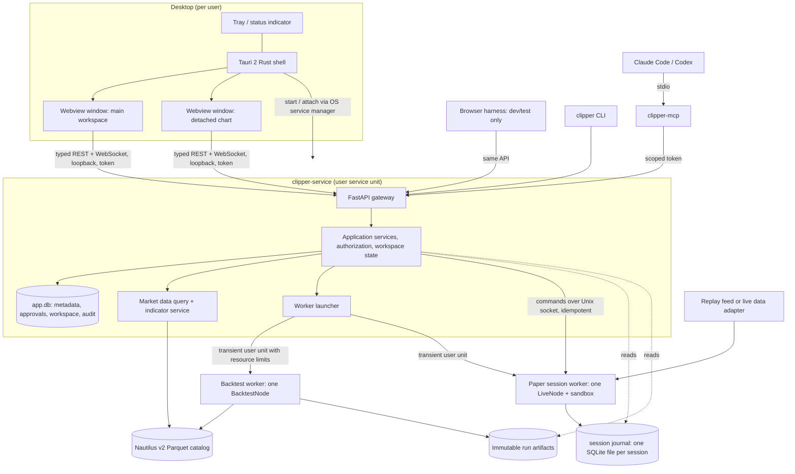
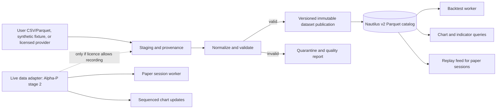

# Clipper Terminal: system design

**Status:** Proposed. This revision (2026-11-25) folds in the
[first independent review](claude-review.md), the
[maintainer decisions](maintainer-decisions.md) D1–D6, and the maintainer's
desktop-first direction on PR #2 (Tauri 2 and Rust, Linux first, Windows
later). The [second review](claude-review-2.md) covers the desktop amendment
and this revision. Not yet approved.
**Product:** Whalesback Systems LLC. **License:** AGPL-3.0-or-later, confirmed
by the maintainer (D3).

## 1. Product and scope

Clipper is a desktop-first, local-first, open-source quantitative trading
workstation that AI agents can drive. It offers professional charting, Python
strategy development, reproducible NautilusTrader backtests and paper trading.
Humans and AI agents use the same application services. Clipper is independent
of Leviathan: integration goes through public APIs and MCP and is never a
required dependency. (Leviathan is not defined anywhere in these documents;
see review 2, P2-7.)

**Platforms:** Linux desktop first, with Pop!_OS 24.04 LTS on x86-64 as the
reference (§13). Windows desktop comes later. Alpha decisions must not make it
impossible (§11). macOS is not planned.

**Alpha is two milestones (D4):**

- **Alpha-R (research).** MCP comes first. Import data, check coverage, run
  deterministic backtests, and inspect results and trade logs, first from
  Claude Code and Codex over MCP, then from the CLI. Then a native desktop
  workspace with charts, results, trade markers and AI-controllable chart
  state. Built from synthetic fixtures and user-imported data, with no paid
  credentials.
- **Alpha-P (paper).** Session-scoped paper trading (D1). Sessions are first
  driven by replayed catalog data, then by one live market-data feed. Human
  approval of orders, a durable trade journal for every session, stop, cancel
  and emergency stop.

**Out of scope for alpha:**
- real-money trading (no execution adapter that can reach a real account is
  in the build)
- resuming a paper session after a restart (D1, deferred)
- strong authorization against a same-user agent (D2, deferred)
- Pine compatibility, options, shorting or margin, tick-level strategies
- advanced drawing tools, an in-app code editor, distributed compute
- a browser product, data redistribution, a marketplace, Cloud or
  multi-tenancy

**Primary journeys:**
1. *(Alpha-R, MCP)* An agent imports a dataset, checks its coverage, runs a
   backtest of a strategy file at a recorded hash, and reads the results and
   trade log. No desktop window is needed.
2. *(Alpha-R, desktop)* The user picks an instrument, resolution and session,
   inspects candles and coverage, runs the same backtest, and reviews fills,
   equity, P&L, drawdown and warnings. Evidence can be exported.
3. *(Alpha-R, desktop and AI)* The agent inspects the open charts and layout,
   and changes symbol, timeframe and indicators. Every open window converges
   on the same state.
4. *(Alpha-P)* The user starts a paper session with virtual capital, approves
   an order or a bounded strategy deployment, watches simulated fills, and
   stops or cancels safely. Closing windows or disconnecting the agent does not
   stop the session.
5. *(Alpha-P)* A worker crash, reboot or upgrade ends the session as
   *interrupted*. Its journal stays intact and readable, and a new session
   starts only when the user asks. Funds are never reset silently.

## 2. Runtime and language ownership

| Layer | Language / runtime | Owns | Must not own |
|---|---|---|---|
| Desktop shell | Rust, Tauri 2 (`tauri` 2.12.x) | Native windows, launching and attaching to the service, single instance, tray/indicator, packaging, a narrow OS integration surface | Trading logic, matching, accounting, strategy execution, worker lifecycle |
| UI | React + TypeScript in the Tauri webview (WebKitGTK on Linux, WebView2 on Windows later) | Rendering typed read models, Lightweight Charts, docking layout, approval screens | Authoritative state, financial calculation, indicator values of record |
| Local service | Python 3.13, FastAPI, Pydantic | Application services, authorization, approvals, workspace state, MCP, CLI, job and session lifecycle, persistence | Window management |
| Engine | NautilusTrader v2 (Rust core with a PyO3 Python API) inside Python worker processes | Backtest and sandbox matching, order state, portfolio | Anything outside one worker process |

Rust enters Clipper in two ways: through the shell, and through NautilusTrader's
own core. **Nautilus crates are not linked into the shell.** Linking them would
duplicate the engine outside the worker boundary. It would also turn the LGPL
dependency into a static-linking case with relinking obligations (§12). The
shell talks to the service only over its public API.

## 3. Component topology



### Responsibilities and interfaces

- **Shell (Rust/Tauri):**
  - Starts or attaches to exactly one service per user profile, through the
    OS service manager (§4). It never spawns the service as a child process.
  - Verifies the service with an authenticated version handshake.
  - Creates and restores windows, and shows a tray or status indicator while
    jobs or paper sessions are active.
  - Exposes an enumerated set of Tauri commands: get session bootstrap, open
    or close window, reveal log folder, service status, stop service. There
    are no shell, filesystem or HTTP-proxy capabilities, and the webview loads
    only bundled assets.
- **UI (React/TS):** one shared codebase for every window. Talks to the service
  through the OpenAPI-generated TypeScript client and a WebSocket event
  stream. Each window is a separate webview with its own JS context, so no
  state of record lives in a React store. Windows render read models and
  resnapshot when they see a sequence gap.
- **Gateway and application layer (Python):**
  - One command path for desktop, CLI, MCP and the dev browser.
  - Owns identities, scopes, approvals, idempotency, run manifests, the
    job and session lifecycle, **workspace state** (§5) and read-model
    projection.
- **Indicator service:** indicator series are computed **in the service**, so
  the chart and the agent see identical values. The UI only renders them.
  Lightweight Charts has no built-in indicators.
- **Worker launcher:**
  - One Nautilus node per process, as upstream requires.
  - On Linux, workers run as transient systemd user units with cgroup limits
    (`MemoryMax`, `CPUQuota`, `RuntimeMaxSec`), so they outlive service
    restarts.
  - The launcher sits behind an interface so Windows can use Job Objects later.
  - No Redis, Celery or Kubernetes.
- **Trading adapter:** an anti-corruption layer over the pinned Nautilus v2
  API: configuration, instrument mapping, event translation, strategy loading
  and a capability matrix. Domain DTOs never depend on engine types. No fork,
  and no duplicated matching or accounting.
- **Data:**
  - The Nautilus v2 catalog is the canonical store for historical data.
  - `app.db` (SQLite WAL) holds metadata, workspace state and audit, with the
    gateway as its single writer.
  - Each paper session has its own journal file, written only by that
    session's worker (§7).
  - Run artifacts are immutable files.
  - No DuckDB or Polars in alpha. The catalog's `query` and
    `query_data_arrow_stream` APIs are enough.
- **Credentials:** data-provider keys live in the user's config directory with
  `0600` permissions and never appear in process arguments, logs, manifests or
  agent responses. In alpha they are readable by any same-user process,
  including agents (D2, §9).

### Repository layout (proposed, not yet created)

```text
apps/desktop/              Tauri 2 shell (src-tauri/ Rust), packaging config
apps/web/                  Shared React workspace; browser dev harness
src/clipper/
  domain/                  DTOs, IDs, invariants
  application/             use cases, authorization, workspace state, ports
  api/                     FastAPI / WebSocket
  cli/  mcp/               clipper, clipper-mcp
  market_data/             import, validation, catalog, indicators
  trading/                 Nautilus v2 adapter, capability matrix, fee models
  workers/                 launcher (systemd now, Windows later), backtest, paper session
  persistence/             app.db, session journals, artifacts
packaging/linux/           user units, .deb layout, runtime build scripts
strategies/examples/
tests/{unit,integration,financial,e2e}/
docs/architecture/  docs/adr/
```

## 4. Desktop shell, service lifecycle and packaging

**Why not a Tauri sidecar.** Tauri's `externalBin` sidecars are started through
`tauri-plugin-shell`. That plugin kills every child it tracks when the app
exits (`RunEvent::Exit`), while a *crash* leaves those children orphaned. A
paper session would therefore stop on a normal quit and keep running
unsupervised after a crash, which is the opposite of what Clipper needs. The
shell does **not** use `tauri-plugin-shell` at all, which also removes a broad
capability from the attack surface.

**Linux lifecycle (alpha):**
- The `.deb` installs `clipper.service` as a systemd **user** unit.
- The shell starts the service through the user service manager, over D-Bus
  or `systemctl --user`, from Rust code the webview cannot reach. MCP and CLI
  do the same in headless use.
- The service writes `$XDG_RUNTIME_DIR/clipper/service.json` (`0600`), holding
  the port, PID, instance ID and version. The shell reads it, then performs an
  authenticated health and version handshake. It never trusts a port that is
  merely listening, and it rejects stale or mismatched endpoints.
- A single-instance lock (`tauri-plugin-single-instance`) stops a second
  launch from creating a second shell. The service unit's own locking stops a
  second service.
- Closing a window never stops jobs or sessions. Closing the last window
  detaches if anything is active, with the tray indicator still visible, and
  exits fully if idle.
- "Stop service" is an explicit action that reports outstanding orders and
  workers before stopping.
- A shell crash affects nothing but the windows.
- The reference machine has lingering enabled (`Linger=yes`), so user units
  survive logout. Clipper still promises no continuity across logout or
  reboot. A paper session interrupted by either ends as *interrupted* (D1).

**Packaging (Linux alpha): one `.deb`.**
- The Tauri bundler produces the shell package and declares
  `libwebkit2gtk-4.1-0`, `libgtk-3-0` and the appindicator library for the
  tray.
- Through `bundle > linux > deb > files`, it also installs:
  - a standalone CPython 3.13 runtime from python-build-standalone;
  - a relocatable virtual environment (`uv venv --relocatable`), populated from
    `uv.lock`, containing `nautilus_trader`, FastAPI, the MCP SDK and Clipper's
    own package;
  - the user unit, and `clipper` and `clipper-mcp` launcher scripts.
- Nautilus stays an ordinary installed wheel that the user can replace, which
  meets LGPL requirements. Clipper does not freeze it into one binary with
  PyInstaller or similar.
- Nothing is downloaded at launch.
- GUI apps do not inherit the user's shell `PATH`, so every path is absolute
  inside the package.
- Build in an Ubuntu 22.04 container. That keeps the glibc floor at or below
  2.35, which still meets Nautilus v2's `manylinux_2_34`.
- AppImage and Flatpak are deferred. Flatpak's sandbox conflicts with
  host-level user units and loopback discovery.

**Webview security:**
- Content Security Policy: `default-src 'self'`, with `connect-src` limited to
  the service's loopback origin. No remote navigation.
- Tauri capabilities list each window's commands, with no wildcards.
- The API validates the `Host` header (against DNS rebinding), allows only the
  exact webview origin (`tauri://localhost` on Linux, and the WebView2 origin
  later on Windows; confirm both in the spike), never uses wildcard CORS, and
  requires a token header on every mutation.
- The webview gets a session token through one Tauri command at startup. The
  token is never baked into the bundle.

**Display server:**
- Wayland does not let apps read or set window positions. Tao documents
  `outer_position` and `set_outer_position` as unsupported there, so restoring
  detached windows to a given monitor cannot work under native Wayland.
- The reference desktop is COSMIC, and the maintainer runs applications under
  X11 through XWayland. Clipper therefore runs under XWayland
  (`GDK_BACKEND=x11`) by default on Linux. Native Wayland is a tested
  secondary mode, where window bounds are best-effort.
- Semantic layout, meaning which chart lives in which window, is saved apart
  from native bounds.

**Rendering risk:**
- Charts render in WebKitGTK, not Chromium. The reference GPU is an NVIDIA
  RTX 4090 on the proprietary 580 driver. Blank or flickering WebKitGTK
  windows on NVIDIA are a known problem area, with workarounds such as
  `WEBKIT_DISABLE_DMABUF_RENDERER=1`.
- All chart performance targets (§10) are measured **inside the Tauri
  webview**. Numbers from desktop Chrome or Playwright WebKit don't count.
- If WebKitGTK fails the targets, the fallback to evaluate is Tauri 3's
  optional CEF (Chromium) runtime (`tauri-runtime-cef`, alpha only today).
  That is a maintainer decision, not an assumption.

**Version policy:**
- Pin `tauri` 2.12.x and the plugins in `Cargo.lock`.
- Tauri 3 is in alpha (`3.0.0-alpha.6`, 2026-11-06), and its breaking changes
  so far fall mostly on the plugin API. Keep the shell small and plugin-light
  so a later move to Tauri 3 is cheap.

## 5. Workspace state and AI desktop control

- The workspace is **authoritative in the service**, stored in `app.db`. It
  holds workspaces, layouts (dock tree plus detached-window assignments),
  charts (instrument, resolution, session, indicator specs, overlays), and a
  revision number for each entity.
- Windows subscribe to changes. Native window IDs are transient; charts have
  stable IDs.
- **MCP workspace tools:** `get_workspace`, `list_charts`, `get_chart_state`,
  `open_chart`, `set_chart_symbol`, `set_chart_timeframe`,
  `set_chart_indicators`, `get_layout`, `set_layout` and `show_backtest`.
  - Mutations carry the expected revision; stale ones return `conflict`.
  - With no window open, mutations persist and return
    `presentation: "pending"`. Clipper never claims that a window showed
    something.
  - The viewport (visible time range) is reported best-effort by the focused
    window, throttled, and treated as presentation hints, not state of record.
- **Scopes:**
  - `research:read` covers data, results and trade logs.
  - `workspace:read` and `workspace:write` cover workspace state.
    `workspace:write` cannot place orders, run code, edit risk policy or
    approve anything.
  - `paper:prepare` (Alpha-P) can create order and deployment *intents*, never
    approve them.
  - Approval and policy routes refuse every MCP token (§9).
  - Native window operations go only through the shell's enumerated commands,
    never through MCP.

## 6. Data design and provider boundary



**Free data first (D5).** Synthetic fixtures and user-supplied CSV or Parquet
are first-class, and they are the CI default. Alpha-R must be complete with
them alone. Databento is the leading paid candidate; its adapter exists in
Nautilus v2. The provider spike compares it with free and low-cost sources on
coverage, history, live entitlement, cost, licence terms (local use and
recording a stream), symbology and rate limits. Every source is checked against
its terms of service before adoption. Clipper does not scrape unofficial
endpoints, and it ships no credentials or licensed data. The data budget is set
after the spike reports costs.

**Correctness rules:**
- **Instrument IDs:** stable IDs include venue and currency. Symbols are
  display names and time-varying aliases.
- **Timestamps:** stored in UTC at nanosecond precision, with an explicit
  exchange calendar and regular- or extended-hours session filter.
- **Bar timestamps:** Nautilus requires `ts_init` at the bar **close** for
  execution, so the catalog stores close-stamped bars. Use adapter settings
  such as `bars_timestamp_on_close`, or add the interval when importing
  open-stamped data.
  - The chart plots bars at their **open** time, in exchange-local time.
    Lightweight Charts has no time-zone support, so the service supplies
    shifted display times.
  - A fill at time *t* is marked on the bar whose interval (open, close]
    contains *t*.
- **Precision:** prices and quantities are normalized to instrument precision.
  Equity price precision is 4 decimal places, to allow sub-dollar ticks under
  Reg NMS Rule 612; otherwise sub-dollar names are excluded. Money and
  quantities cross the API as decimal strings. Floats are used only for chart
  display, and the UI never sums money.
- **Validation:** reject duplicates, conflicts, malformed OHLC, impossible
  volume, out-of-order records and unexplained gaps. Distinguish market
  closures from missing data.
- **Corporate actions:** the engine applies neither splits nor dividends.
  Alpha uses unadjusted prices only, and it refuses or flags datasets that
  cross a known split for the traded instrument. Returns are labelled "price
  return, excludes dividends". There are no total-return benchmark
  comparisons, and no survivorship-bias-free claims until point-in-time
  universes exist.
- **Manifests:** each dataset manifest lists exact immutable files and hashes.
  A dataset is published only after validation, catalog writes are serialized
  per partition, and readers use pinned snapshots.
- **Data status:** a live, delayed, stale, replay or synthetic badge and the
  last update time appear everywhere data is shown. Reconnects detect gaps and
  resnapshot. Ticks are never fabricated.

## 7. Execution semantics

**Engine pin (ADR-002):**
- NautilusTrader **v2**, exact pin (`nautilus_trader==2.0.0rc9` today), in the
  bundled environment, on CPython 3.13.
- Move to `2.0.0` final through one PR that runs the full financial fixture
  suite.
- v1 (1.231.0) is legacy upstream (security backports only, for about three
  months after the v2 cutover). Its catalog schema is incompatible with v2,
  and its sandbox hard-codes the fill and fee models.
- RC API churn stays inside `trading/`. There is no v1/v2 compatibility layer.

**Backtest:**
- **Manifest:** strategy file hash and config, engine, adapter and dependency
  versions, dataset hashes, instrument and calendar, date range, warm-up,
  initial balances, fee, fill and latency model configuration, and the seed.
- **Results:** order and fill events, positions, equity, realized and
  unrealized P&L, fee totals, metric definitions (annualization, risk-free
  rate, return frequency), warnings and logs.
- **Configuration:** venues are pinned explicitly: `account_type=CASH`,
  `default_leverage=1`, an explicit `oms_type`. v2 defaults margin accounts to
  10× leverage.
- **Intrabar ambiguity:** bar execution simulates an O→H/L→C path, and upstream
  has no "reject ambiguous bar" mode. Clipper uses
  `bar_adaptive_high_low_ordering` and runs a post-run **ambiguity detector**
  that flags any bar where a resting stop and a target both fall inside the
  bar's range. Results carry that warning. Orders submitted from `on_bar` are
  processed after that bar, which is documented.
- **Fees:** a Clipper `FeeModel` for US equities (per-share commission with a
  minimum and maximum, plus SEC and FINRA TAF fees on sells). The **same
  configured instance** is used in backtest and paper.
- **Reproducibility:** repeat fixture runs must produce equal normalized
  artifacts. Reference fixtures compute expected ledger values independently.
  There is no second production backtester.
- **Known gaps:** the cash model does not model T+1 settlement, good-faith
  violations, pattern-day-trader rules or borrow. These are documented as
  known gaps.

**Paper sessions (D1):**
- **Engine:** the Nautilus v2 sandbox execution client, fed by a replay feed
  (stage 1) or a live data adapter (stage 2). Fill, fee and latency models are
  configured exactly as in backtests.
- **No restart recovery.** The sandbox keeps matching and account state in
  memory and can be seeded only with `starting_balances`. It reports no fills
  or positions to reconciliation.
- **Cache backing forbidden.** Nautilus cache database backing (Redis or
  Postgres) is **forbidden** for sandbox sessions. A restarted node would
  reload "working" orders that the fresh matching engine does not hold, so they
  never fill, and cash would reset. A kill-and-restart test guards this rule.
- **The journal is the ledger of record.** Each session has one SQLite WAL file
  (`sessions/<id>.db`), written only by its worker. An exclusive `flock` on the
  file is the ownership lease; the kernel releases it when the process dies.
  - The journal records: commands with `UNIQUE(command_id)`, approvals with the
    policy revision, every order and position event with its projection in
    **the same transaction**, account cash and positions after each change, the
    data timestamp that drove each fill, and how the session began and ended.
  - The audit chain is hash-linked.
  - It runs with `synchronous=NORMAL`. A power loss may drop the last
    transaction but not consistency. The simulated venue's state dies with the
    process anyway, so a fill that never reached the journal never happened
    anywhere.
- **Commands:** the service sends commands to the worker over a Unix socket
  (named pipes later on Windows). Each carries a `command_id`. The worker
  journals the command, then acts, then acknowledges. The service retries with
  the same ID until it gets an ack or sees the lock released.
  `ClientOrderId` is derived deterministically from the command ID, after
  checking upstream length and character limits. Delivery is idempotent, and
  there is no UNKNOWN or reconcile state for paper.
- **Session states:** `ready`, `running`, `stopped`, `interrupted`, `archived`.
  *Feed stale* and *policy breach* are flags that block new orders. Job states
  are `queued`, `running`, `succeeded`, `failed`, `cancelled`, `interrupted`.
- **Future resume:** resuming after restart is deferred. The journal records
  command IDs and data timestamps so a later replay-based resume stays
  possible. An upstream issue for a sandbox state snapshot is to be filed.

```mermaid
sequenceDiagram
  participant U as User or AI
  participant A as Clipper service
  participant H as Human (desktop/CLI)
  participant W as Session worker
  participant J as Session journal
  participant N as Nautilus sandbox
  U->>A: prepare_paper_order(session, intent)
  A->>A: Store expiring intent and policy snapshot, compute intent hash
  A-->>U: Preview, risk checks, approval ID (pending)
  H->>A: Approve intent hash (desktop or CLI; MCP token refused)
  A->>A: Consume approval atomically, create command_id
  A->>W: Command(command_id) over Unix socket
  W->>J: Insert command (UNIQUE command_id)
  W->>W: Recheck feed health and Clipper limits
  W->>N: Submit order (ClientOrderId derived from command_id)
  W-->>A: Ack(command_id)
  N-->>W: Order and fill events
  W->>J: Event + projection in one transaction
  A-->>U: Status via query or WebSocket
```

**Limits and stops:**
- Upstream `RiskEngineConfig` provides only submit/modify rate limits and
  per-order notional limits. Clipper adds a pre-trade gate in the worker for
  max position, max loss (marked at the last trade, and blocked while the feed
  is stale), deployment duration, an instrument allowlist and allowed order
  types.
- These are guardrails, not a security boundary against hostile strategy code
  (§9).
- Approvals of market orders carry a price collar.
- Stop strategy, cancel working orders and flatten are separate actions.
  Flatten is a new order that needs its own authorization, and a fill is never
  promised.
- Emergency stop uses upstream trading-state halting (confirm the API at the
  pin) plus cancel-all, and reports what actually happened.

## 8. MCP and API contracts

- **MCP SDK:** the official Python SDK **v2** (`mcp>=2.3,<3`, `MCPServer`),
  over stdio. v1 is maintenance-only.
  - Test against the protocol version each host actually negotiates (2025-11-25
    or 2026-07-28).
  - The SDK lacks the tasks extension, so long work returns job IDs to poll.
  - Elicitation or host confirmation dialogs never count as approval.
  - Remote Streamable HTTP is deferred to Cloud.
- **Alpha-R tools:**
  - Research: `search_instruments`, `import_dataset`, `get_data_coverage`,
    `get_bars`, `list_strategies`, `validate_strategy`, `run_backtest`,
    `get_job_status`, `cancel_job`, `get_backtest_results`, `get_trade_log`.
  - Workspace: the §5 tools.
- **Alpha-P tools:** `list_paper_sessions`, `get_positions`, `get_orders`,
  `get_session_journal`, `prepare_paper_order`, `prepare_paper_deployment`,
  plus `stop_strategy` and `emergency_stop` under an explicitly granted
  safety scope.
- **Resources and output:** resources expose dataset, strategy and run
  summaries by ID, never raw file paths. Output is structured, paginated and
  redacted.
- **REST:** versioned under `/v1`. Mutations carry a request ID, actor,
  idempotency key and expected revision. Typed errors cover `permission`,
  `stale`, `conflict`, `rate_limited`, `validation` and `unavailable`. No stack
  traces.
- **WebSocket:** the envelope carries `schema_version`, `event_id`, `stream`,
  `seq`, `entity_id`, `type`, `occurred_at` and `payload`. `seq` is monotonic
  **per stream**. On a gap the client fetches a snapshot and resumes from its
  `seq`. Subscriptions and buffers are capped.

## 9. Security and threat model

**Local threat model (ADR-015):**
- Claude Code and Codex run as the user, with a shell. They can read Clipper's
  files, its token and provider keys, edit its databases, and drive the UI.
  The reference user is also in the `docker` group, which is root-equivalent.
- In alpha, MCP scopes and human approval protect against agent **mistakes**,
  not a hostile same-user agent (D2). The docs state this plainly.

**Alpha controls:**
- The server refuses approval and policy routes to MCP tokens.
- Approvals are bound to an intent hash, a single use and an expiry.
- The audit chain is hash-linked, so edits made outside Clipper are detectable.
- The local web defences from §4 apply.
- Secrets are redacted everywhere.

**Future** (required before real-money trading, Cloud, or running strategies
of unknown origin):
- Approval requires proof of human presence that an agent cannot produce, for
  example WebAuthn with user verification over the intent hash.
- Credentials are isolated from agents.
- Strategies run in OS-level isolation.

**Strategy trust (ADR-010):**
- A strategy is "trusted" when it is **a workspace file at a content hash that
  the user acknowledged**.
- Alpha does not sandbox strategies. Against a same-user agent with a shell,
  local sandboxing adds no protection.
- The worker launcher is the single seam where bubblewrap, nsjail or a
  rootless container can be added for untrusted code and for Cloud.
- Paper workers need network access and provider credentials while a live
  feed is used. Isolating strategies from those requires splitting the feed
  into its own process, which is recorded as a prerequisite for untrusted
  code.

## 10. UI and performance

**Layout:**
- A dark, desktop-first workspace, without copying any proprietary assets.
- The toolbar shows symbol, timeframe, session, data status and the
  environment badge (RESEARCH or PAPER).
- Docked panels: chart tools; chart (candles, volume, overlays, trade markers);
  watchlist and instrument details; and a bottom dock with backtest report,
  trade log, read-only strategy source and hash, session journal and logs.
- Keyboard navigation and accessible focus. Order state is never shown by
  colour alone.

**Window delivery path:**
1. One native window with docked panels (first Alpha-R slice).
2. Detachable chart windows on multiple monitors (before Alpha-R is
   complete).
3. Restoring windows to the right monitor after relaunch, with fallback to a
   visible display. Best-effort under Wayland (§4).

**Charting:**
- Lightweight Charts 5.3, plus the official `session-highlighting`,
  `user-price-lines` and `accessibility` plugins.
- Drawing tools are custom and come after alpha.
- The in-app code editor (Monaco) is out of alpha. Strategies are files the
  user or agent edits with their own tools, and the UI shows the source
  read-only, with its hash.

**Targets** (provisional; measured **inside the Tauri webview** on the
reference machine with fixture data):

| Measure | Target |
|---|---|
| Cold service start | < 10 s |
| First chart of 5k bars after the service is ready | < 2 s p95 |
| Pan and zoom with 10k visible bars | about 60 FPS |
| Cached reads | p95 < 200 ms |
| Event to UI | p95 < 250 ms |
| Concurrent load | two backtests running without UI starvation |
| Peak memory per backtest worker | to be set after profiling |
| Webview memory per window | to be recorded in the spike |

Benchmarks record the workload, engine pin, display mode (XWayland or
Wayland) and GPU driver.

## 11. Platform portability: Linux first, Windows later

Windows is not built or tested in alpha. These rules keep it reachable
(ADR-018):

| Concern | Linux alpha | Windows later | Rule now |
|---|---|---|---|
| Service lifecycle | systemd user unit | Per-user background process started by the shell, or a logon task | The shell's service manager sits behind a Rust trait. No systemd types leak out. |
| Worker supervision | Transient user units with cgroup limits | Job Objects | The Python `WorkerLauncher` interface. Workers never depend on systemd. |
| IPC | Loopback TCP for API; Unix socket for worker commands | Loopback TCP; named pipes | Abstract the command transport. |
| Locks | `flock` | `LockFileEx` | A cross-platform lock library. |
| Paths | XDG directories | Known Folders | `platformdirs` in Python and the `directories` crate in Rust. No hard-coded `/`. |
| Webview | WebKitGTK 4.1 | WebView2 (Chromium) | Test charts in both before Windows ships. Never rely on engine-specific CSS or JS. |
| Webview origin | `tauri://localhost` | `http://tauri.localhost` (verify) | The origin allowlist is configured per platform. |
| Engine | Nautilus v2 `manylinux_2_34` wheel | Nautilus v2 `win_amd64` wheel (published) | No Linux-only Python dependencies in the service. |
| Packaging | `.deb` with bundled runtime | MSI or NSIS installer, code signing | Keep the runtime build scripted and per-target. |
| Stop signals | SIGTERM | Ctrl-Break / job termination | Graceful-stop commands go over IPC, not signals. |

## 12. Licensing and the Cloud boundary (D3)

- The self-hosted core stays AGPL-3.0-or-later. Clipper Cloud may be
  proprietary, and Whalesback Systems LLC keeps the ability to dual-license.
- A CLA is required before the first external contribution, and its text needs
  legal review first (`CONTRIBUTING.md`, ADR-014). No external contributions
  are merged until it is adopted.
- Dual-licensing covers only code Whalesback owns or holds rights to.
  Dependencies keep their own licences.
  - NautilusTrader: LGPL-3.0. Kept replaceable and dynamically loaded; not
    linked into the Rust shell.
  - Tauri: MIT/Apache-2.0.
  - Lightweight Charts: Apache-2.0. Reproduce its NOTICE and keep the
    attribution.
  - WebKitGTK: LGPL, a system library.
  - Rust crates and npm packages: inventoried with `cargo-about` or
    `cargo-deny` and an npm licence checker in CI.
- Cloud is a separate product. It reuses public Clipper interfaces, isolates
  each tenant, uses authenticated remote MCP, and complies with AGPL §13 for
  any AGPL component it runs.
- Market-data agreements and regulatory review gate any commercial launch.

## 13. Reference platform (D6)

| Item | Value |
|---|---|
| OS | Pop!_OS 24.04 LTS, kernel 7.0.11, glibc 2.39 |
| Desktop | COSMIC. The session is Wayland, with XWayland on `:1`; apps run under X11 |
| Hardware | AMD Ryzen 7 7700X, 61 GiB RAM, NVMe SSD |
| GPU | NVIDIA RTX 4090, proprietary driver 580.159.03 |
| Webview runtime | `libwebkit2gtk-4.1-0` 2.52.3; `libayatana-appindicator3-1` present |
| Session services | systemd user session, `Linger=yes` |
| Toolchain | uv 0.11.27 (CPython 3.13 to be installed), Node 24.18.0, bubblewrap 0.11.0, Docker 29.6.1 |

**Testing:**
- Desktop end-to-end tests use WebdriverIO with `@wdio/tauri-service`, or
  `tauri-driver`. Both support Linux and later Windows.
- Playwright covers only the browser dev harness and API-level tests.
- CI runs headless on Ubuntu with Xvfb. The display, GPU, multi-monitor and
  performance tests run on the reference machine.

## 14. Evidence

Upstream facts and the commands that reproduce them are in
[`claude-review.md`](claude-review.md) (engine, MCP, charts) and
[`claude-review-2.md`](claude-review-2.md) (Tauri, webview, platform). Nothing
has been installed or run for this design. The
[desktop validation spike](desktop-validation.md) and the engine pin spike
produce the runtime evidence. See [ADRs](../adr/0001-alpha-architecture-decisions.md)
and the [implementation plan](implementation-plan.md).
