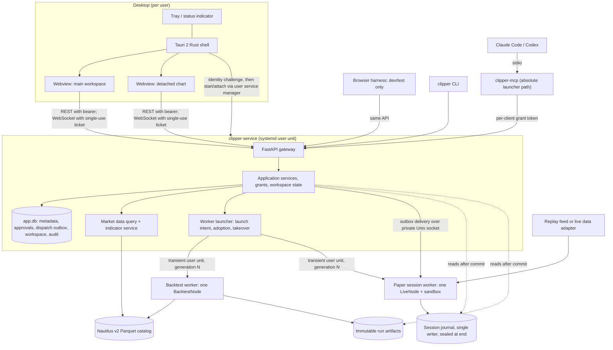

# Clipper Terminal: system design

**Status:** Proposed, not yet approved.
- **Revision 3 (2026-11-25)** fixes the findings of the independent
  [Codex review](codex-review.md).
- Revision 2 folded in the [first Claude review](claude-review.md), the
  maintainer's desktop-first direction on PR #2 and the
  [second Claude review](claude-review-2.md).
- All maintainer decisions D1–D12 in [`maintainer-decisions.md`](maintainer-decisions.md)
  apply.
- Items marked **(pending P*n*)** are proposed defaults that await a maintainer
  decision; they are listed in the [ADR file](../adr/0001-alpha-architecture-decisions.md#pending-maintainer-decisions).

**Product:** Whalesback Systems LLC. **License:** AGPL-3.0-or-later (D3).

## 1. Product and scope

Clipper is a desktop-first, local-first, open-source quantitative trading
workstation. AI agents control it through MCP (D8). It offers professional
charting, Python strategy development, reproducible NautilusTrader backtests
and paper trading. Humans and AI agents use the same application services.
Clipper is independent of Leviathan: integration goes through public APIs and
MCP and is never a required dependency. Leviathan is not defined in these
documents; the maintainer should define the term or remove it.

**Platforms:** Linux desktop first, with Pop!_OS 24.04 LTS on x86-64 as the
reference (§13). Windows desktop comes later; alpha must not rule it out (§11).
macOS is not planned.

**Alpha milestones (D4):**

- **Alpha-R (research):** MCP comes first. An agent imports data, checks
  coverage, registers strategies and runs deterministic backtests, then reads
  the results and trade logs over MCP. A human acknowledges each strategy
  through the CLI. After that comes a CLI on the same services, then a native
  desktop workspace with charts, results, trade markers and AI-controllable
  chart state. Everything works on synthetic fixtures and user-imported data,
  with no paid credentials.
- **Alpha-P (paper):** paper trading in sessions that end on any restart (D1).
  Sessions are driven first by replayed catalog data, then by one live
  market-data feed. Orders need human approval, every session keeps a durable
  trade journal, and stop, cancel and emergency stop are supported.

**Out of scope for alpha:**
- real-money trading (§7 sets the artifact gate);
- resuming a paper session after a restart (D1);
- strong authorization against an agent running as the same user (D2);
- Pine compatibility, options, shorting, margin, and tick-level strategies;
- advanced drawing tools and an in-app code editor (D9);
- distributed compute and a browser product;
- data redistribution, a marketplace, Cloud, and multi-tenancy.

**Primary journeys:**
1. *(Alpha-R, MCP)* An agent imports a dataset and checks its coverage. It
   registers a strategy, which is snapshotted. The human acknowledges the
   strategy with `clipper strategy approve <id>`. The agent then runs a
   backtest and reads the results and trade log. No desktop window is needed.
2. *(Alpha-R, desktop)* The user picks an instrument, resolution and session.
   They inspect candles and coverage, then run the same backtest and review
   fills, equity, P&L, drawdown and warnings. The evidence can be exported.
3. *(Alpha-R, desktop and AI)* The agent inspects the open charts and layout
   and changes symbol, timeframe and indicators. Every window converges on the
   same state.
4. *(Alpha-P)* The user starts a paper session and approves an order or a
   bounded deployment. They watch simulated fills, then stop or cancel safely.
   Closing windows or disconnecting the agent does not stop the session.
5. *(Alpha-P)* A worker crash ends the session as *interrupted*. So do logout,
   reboot and package upgrade, unless the session was drained first (§4,
   pending P4). Exactly one terminal record is written, and the journal stays
   sealed and readable. A new session starts only when the user asks for one.

## 2. Runtime and language ownership

| Layer | Language / runtime | Owns | Must not own |
|---|---|---|---|
| Desktop shell | Rust, Tauri 2 (`tauri` 2.12.x) | Native windows, starting and attaching to the service, single instance, tray, packaging, a narrow set of OS integrations | Trading logic, strategy execution, signals to workers |
| UI | React + TypeScript in the Tauri webview (WebKitGTK on Linux; WebView2 on Windows later) | Rendering typed read models, Lightweight Charts, docking layout, approval screens | State of record, financial calculations, indicator values of record |
| Local service | Python 3.13, FastAPI, Pydantic | Application services, authorization, approvals, dispatch outbox, workspace state, MCP, CLI, job and session lifecycle | Window management |
| Engine | NautilusTrader v2 (Rust core with a PyO3 Python API) inside worker processes | Matching for backtests and the sandbox, order state, portfolio | Anything outside its own worker process |

Rust appears only in the shell and inside NautilusTrader's own core. The shell
never links Nautilus crates: that would duplicate the engine outside the worker
boundary, and it would turn an LGPL dependency into a static-linking case
(§12).

## 3. Component topology



### Responsibilities

- **Shell (Rust/Tauri):**
  - Starts or attaches to exactly one service per user profile, after the
    service proves its identity (§4). It never spawns the service as a child
    process.
  - Creates and restores windows, and shows a tray indicator while jobs or
    sessions are active.
  - Exposes only enumerated Tauri commands, declared through
    `AppManifest::commands` so the capability ACL applies to each window (§4).
- **UI (React/TS):**
  - One shared codebase for every window. Each window is a separate webview
    with its own JS context, so no state of record lives in a React store.
  - Windows render read models, subscribe through the stream contract (§8),
    and resnapshot on a gap or an epoch change.
- **Gateway and application layer (Python):**
  - One command path for the desktop, CLI, MCP and the dev browser.
  - Owns grants and scopes, server-derived actors, approvals, the dispatch
    outbox, run manifests, strategy snapshots, job and session lifecycle,
    workspace state (§5) and read-model projection.
- **Indicator service:** computes indicator series in the service, so the
  chart and the agent see identical values. Lightweight Charts has no
  indicators of its own.
- **Worker launcher:**
  - One Nautilus node per process, as upstream requires.
  - Before starting a worker, it persists a **launch intent** (session ID,
    generation, unit name) in `app.db`. That lets a restarted service find and
    adopt surviving workers.
  - On Linux, workers are transient systemd user units with cgroup limits.
  - It performs **terminal takeover** for dead workers (§7).
  - It sits behind ownership, fencing, timeout and adoption interfaces, so a
    Windows launcher can be added later (§11).
- **Trading adapter:** an anti-corruption layer over the pinned Nautilus v2
  API. It covers configuration, instrument mapping, event translation,
  snapshot loading and the capability matrix. It does not fork the engine or
  duplicate its matching or accounting, and it does not use Nautilus's
  pandas-based report generation. Results come from a typed event projection,
  so pandas is not a dependency.
- **Data:**
  - The Nautilus v2 catalog is the canonical store for historical data.
  - `app.db` (SQLite WAL with `synchronous=FULL`) has the gateway as its only
    writer.
  - Each paper session has one journal file (WAL, `synchronous=FULL`) with one
    writer at a time, enforced by a lease (§7).
  - Run artifacts are immutable.
  - No DuckDB or Polars.
- **Credentials:** provider keys live in the user's config directory with
  `0600` permissions. They never appear in process arguments, URLs, logs,
  manifests, agent responses or SDK telemetry. In alpha any same-user process
  can read them (D2, §9).

### Repository layout (proposed, not yet created)

```text
apps/desktop/              Tauri 2 shell (src-tauri/ Rust), packaging config
apps/web/                  Shared React workspace; browser dev harness
src/clipper/
  domain/                  DTOs, IDs, invariants, approval envelope
  application/             use cases, grants, outbox, workspace state, ports
  api/                     FastAPI REST, stream tickets, WebSocket
  cli/  mcp/               clipper, clipper-mcp
  market_data/             import, validation, catalog, calendars, indicators
  trading/                 Nautilus v2 adapter, capability matrix, fee/fill/latency specs
  strategies/              snapshot store, static validation
  workers/                 launcher (systemd now, Windows later), backtest, paper session
  persistence/             app.db, session journals, artifacts, online backup
packaging/                 engine wheel build, runtime prefix build, user units, .deb
strategies/examples/
tests/{unit,integration,financial,fault,e2e}/
docs/architecture/  docs/adr/
```

## 4. Desktop shell, service lifecycle and packaging

**No sidecars.**
- Tauri sidecars run under `tauri-plugin-shell`. That plugin kills every child
  it tracks when the app exits normally (`RunEvent::Exit`), so a sidecar
  service would stop on an ordinary quit.
- The shell does not use `tauri-plugin-shell` at all. That removes the
  dependency on its behaviour and a broad capability.

**Service identity before credentials.**
- The service writes `$XDG_RUNTIME_DIR/clipper/service.json` (`0600`, inside a
  `0700` directory) holding its port, PID, instance ID, epoch and version.
- The shell, CLI and MCP do not send a reusable bearer token to that port
  until the service has **proved its identity**:
  1. The client sends a random challenge.
  2. The service replies with `HMAC-SHA256(install_secret, instance_id ‖ epoch ‖ challenge)`.
     The install secret lives in the user's config directory (`0600`).
  3. The client verifies the reply. A spoofed listener cannot compute it.
- Only after a valid proof does the client authenticate with its bearer token.
  Stale files and wrong versions are rejected.

**Lifecycle on Linux (alpha):**
- **Install.** The `.deb` installs `clipper.service` as a systemd user unit.
- **Start.** The shell, CLI and MCP start it through the user service manager
  (D-Bus or `systemctl --user`). That happens in Rust or Python code the
  webview cannot reach.
- **Single instance.** `tauri-plugin-single-instance` (which uses session D-Bus
  on Linux) prevents a second shell. The unit itself prevents a second service.
- **Closing windows.** Closing a window never stops work. Closing the last
  window detaches the shell when something is active, and the tray stays
  visible; when nothing is active, the shell exits.
- **"Stop service".** This is an enumerated command, and its native effect is
  fixed:
  1. The shell shows a native confirmation dialog.
  2. It calls the service's authenticated `POST /v1/service/shutdown`.
  3. The service drains: it admits no new work, cancels backtests, and ends
     paper sessions through the normal end path.
  4. It reports the outcome, and the unit exits.

  The shell never signals workers or invokes `systemctl` on their units.
- **Restart, upgrade, logout and reboot.** These are distinct cases:
  - *Service restart* (crash, or manual restart without an upgrade): workers
    keep running. The restarted service adopts them through their launch
    intents: it checks that each lease is held and verifies the worker's
    generation over its socket.
  - *Package upgrade:* each version installs into its own prefix (see
    Packaging), so running workers keep their own files. The shell will not
    restart the service onto a new version while paper sessions are active.
    It asks the user to drain them first. Mixed-version workers are never
    adopted.
  - *Logout* **(pending P4):** paper workers run as units bound to
    `graphical-session.target` (`PartOf=`), so the end of the desktop session
    drains them. Each ends with the reason `logout`. Backtests finish or are
    cancelled. `Linger=yes` would otherwise keep them alive.
  - *Reboot or power loss:* sessions that were not drained end as
    *interrupted*. On its next start, the service performs terminal takeover
    (§7).

**Packaging (Linux alpha): one `.deb` (D11).**
- **Layout:**
  - The shell and its dependencies, as declared by the Tauri bundler:
    `libwebkit2gtk-4.1-0`, `libgtk-3-0`, and appindicator for the tray.
  - A **fixed, versioned prefix**, `/opt/clipper/<version>/`, containing a
    standalone CPython 3.13 from python-build-standalone and a virtual
    environment.
  - A `/opt/clipper/current` symlink to the active version.
  - User units, plus `clipper` and `clipper-mcp` launchers that call
    `/opt/clipper/<version>/venv/bin/python` directly.
- **Building the environment:**
  - Build it **at its final path** inside the build container, from locked,
    non-editable wheels. Relocation is not relied on. Codex reproduced
    `uv venv --relocatable` with uv 0.11.27 leaving the interpreter symlink and
    `pyvenv.cfg` pointing at the staging path.
  - After the build, verify the package: no build paths remain (grep), ELF
    dependencies are all present (`ldd`), and native imports work.
  - Build on an Ubuntu 22.04 base. Record the floor of the assembled package,
    not just one wheel's tag.
- **Runtime rules:** nothing is downloaded at launch, and all paths are
  absolute, because GUI apps don't inherit `PATH`. The service removes an old
  prefix only once no worker uses it.
- **Engine artifact:** see §7.
- **LGPL replacement path:** see §12.
- **Other formats:** AppImage and Flatpak are deferred.

**Webview security:**
- **Commands.** Commands are declared through `AppManifest::commands` in
  `build.rs`, and each window's capability grants only what that window needs.
  Without the manifest declaration, `invoke_handler` commands are available to
  every window.
- **Navigation.** Navigation and new windows are denied through
  `on_navigation` and the new-window handler. That is separate from CSP.
- **CSP.** `default-src 'self'`; `connect-src` lists the exact service origin,
  built at runtime because the port is dynamic. No remote content.
- **REST.** The webview gets a short-lived bearer through one bootstrap
  command. It is rotated on attach and never stored in the bundle or in URLs.
- **WebSocket.** Browsers cannot set custom headers on a WebSocket. The webview
  therefore requests a **single-use stream ticket** (`POST /v1/stream-tickets`,
  bound to the instance, epoch, scope and origin, valid for 30 seconds) and
  presents it as a `Sec-WebSocket-Protocol` value. Reusable bearers never
  appear in URLs or traces.
- **Origin and Host.**
  - Webview tokens require the exact webview origin: `tauri://localhost` on
    Linux, and `http://tauri.localhost` on Windows later. Record the actual
    HTTP and WebSocket `Origin` values in the spike.
  - CLI and MCP grants are accepted without an `Origin` header, and are refused
    if a browser `Origin` is present.
  - If WebKitGTK sends an opaque (`null`) origin, the transport must change, to
    a thin Rust bridge, before the webview is authorized.
  - The `Host` header is validated against DNS rebinding. No wildcard CORS.

**Display server (D7):**
- Wayland does not let apps read or set window positions: tao documents
  `outer_position` and `set_outer_position` as unsupported there.
- Clipper therefore runs under XWayland (`GDK_BACKEND=x11`) by default.
  Detached-window restore must work there.
- Native Wayland is a tested secondary mode with best-effort bounds.
- `tauri-plugin-window-state` checks saved bounds against the current
  monitors. Clipper adds its own fallback to a visible display.
- Semantic layout is stored apart from native bounds.

**Rendering risk:**
- Charts render in WebKitGTK on an NVIDIA RTX 4090 with the proprietary 580
  driver. WebKitGTK's behaviour there varies, and its DMABUF renderer has a
  diagnostic switch.
- All targets are measured inside the Tauri webview (§10).
- If XWayland misses the targets, Phase 0 may evaluate Tauri 3 with CEF (D10).
  If only native Wayland passes, the evidence goes back to the maintainer under
  D7 and D10 **(pending P5)**.

**Version policy:** Tauri is pinned to 2.12.x (plugins: `single-instance`
2.5.x and `window-state` 2.5.x). Keep the shell thin so a later move to Tauri
3, currently `3.0.0-alpha.6`, is cheap. Candidate pins are kept apart from
tested selections (§14).

## 5. Workspace state and AI desktop control

MCP is the primary interface for AI control (D8). Every capability an agent
needs is an MCP tool, except human approvals, policy changes and native window
operations. Driving the UI through injected input, screenshots or computer use
is not a supported path, and no feature may depend on it.

- **Where state lives.** The workspace is authoritative in the service, in
  `app.db`. That covers workspaces, layouts (the dock tree and detached-window
  assignments), and charts (instrument, resolution, session, indicator specs
  and overlays). Every entity has a revision.
- **Windows.** Native window IDs are transient; chart IDs are stable.
- **Workspace tools:**
  - The tools are `get_workspace`, `list_charts`, `get_chart_state`,
    `open_chart`, `set_chart_symbol`, `set_chart_timeframe`,
    `set_chart_indicators`, `get_layout`, `set_layout` and `show_backtest`.
  - Every mutation carries the expected revision. A stale revision returns
    `conflict`.
  - With no window open, the mutation persists and returns
    `presentation: "pending"`.
  - The viewport is a best-effort, throttled hint, not state of record.

## 6. Data design and provider boundary


**Free data first (D5).**
- Synthetic fixtures and user-supplied CSV or Parquet are first-class, and
  they are the CI default.
- Databento is the leading paid candidate; its adapter exists in v2.
- The provider spike compares cost, coverage, entitlements, licence terms
  (local use, exports, retention or recording), symbology and rate limits. It
  also checks whether bar data and live quote/trade data match equivalently.
- Every source is checked against its terms of service. Clipper never scrapes
  unofficial endpoints and ships no credentials or licensed data.
- The data budget is set after the spike.

**Correctness rules:**
- **Instrument IDs.** Instrument IDs are stable and include venue and
  currency. Symbols are display aliases that can change over time.
  Instrument metadata (price increment, lot size, listing and delisting) is
  versioned and pinned in each manifest.
- **Time and calendar.**
  - Every record keeps separate UTC values: event identity, availability
    (`ts_init`), submission, and execution time. Chart labels are derived from
    these and never stored as truth.
  - The exchange calendar version is pinned per manifest, including half days.
    DST is handled in the calendar, not in display shifts.
  - Warm-up cutoffs are explicit.
- **Bar timestamps.** Nautilus needs `ts_init` at the bar **close**, so the
  catalog stores close-stamped bars (via `bars_timestamp_on_close`, or by
  adding the interval when importing open-stamped data). The chart plots bars
  at their open, in exchange-local display time.
  - Lightweight Charts has no time-zone support, so the service supplies
    shifted display times. Lightweight Charts' own guide warns about DST
    ordering hazards when shifting, and fixtures cover that.
  - Trade markers are placed by the **execution timestamp**. Each fill also
    records the ID of the feed event that triggered it, so the marker is not
    inferred from interval arithmetic alone.
- **Precision and ticks.**
  - Storage uses 4 decimal places for equity prices. That is representational
    precision, not a rule about valid order prices.
  - Order prices are validated against the instrument's increment rules as of
    the data date. Quote and order increment rules (Reg NMS Rule 612, whose
    amendment has a November 2027 compliance date) stay separate from the
    precision of trade prints.
  - Money and quantities cross the API as decimal strings, and the UI never
    sums money.
- **Validation.** Reject duplicates, conflicts, malformed OHLC, impossible
  volume, out-of-order records and unexplained gaps. Distinguish market
  closures from missing data.
- **Corporate actions: fail closed.**
  - Prices are unadjusted only.
  - A dataset that crosses a known split for a traded instrument is
    **refused**, not just flagged.
  - Returns are labelled "price return, excludes dividends".
  - No total-return benchmarks, and no claims to be free of survivorship bias.
- **Manifests.** Each manifest lists exact files and hashes, and readers read
  exactly those files. Catalog writes are serialized per partition.
- **Data status.** Every view of data shows a live, delayed, stale, replay or
  synthetic badge and the last update time. Reconnects detect gaps and
  resnapshot, and Clipper never fabricates ticks.

## 7. Execution semantics

### Engine pin and artifact gate (ADR-002)

**Pin:** NautilusTrader v2 (`2.0.0rc9` today) on CPython 3.13. The move to
`2.0.0` final goes through one PR that runs the full fixture suite. RC churn
stays inside `trading/`.

**Artifact gate (D1).** The ordinary PyPI rc9 wheel contains importable
**Binance and Interactive Brokers execution factories**. Codex verified this,
and it violates D1's rule that no build contains an adapter able to reach a
real account. Upstream puts every adapter, including `sandbox` and `databento`,
behind one `adapters` feature (`crates/pyo3/Cargo.toml` at rc9).

**Proposed default (pending P1):**
- Phase 0 builds a **simulation-only wheel** from the exact upstream tag. The
  build applies a small, auditable change to the feature list, enabling only
  `nautilus-sandbox` and `nautilus-databento`. It also removes the Python
  modules of the excluded adapters.
- The build records its provenance (tag, patch, toolchain, checksums) and
  publishes source for the wheel.
- Clipper proposes per-adapter features upstream.

**Gate:**
- Inspect the shipped wheel and native module. List the available execution
  factories: only the sandbox may appear.
- Run backtest and sandbox smoke tests from a clean install.

If the restricted build is not feasible, the maintainer decides between
maintaining that build patch and amending D1.

### Backtests

**Manifest:**
- strategy snapshot hash;
- engine, adapter and dependency versions;
- dataset files and hashes, instrument metadata and calendar versions;
- date range and warm-up;
- initial balances;
- fill, fee and latency **specification IDs and versions**;
- execution-timing policy;
- seed.

**Results:**
- order and fill events, each linked to its triggering feed event;
- positions, equity, realized and unrealized P&L, and cost basis;
- fee totals;
- metric formulas (annualization, risk-free rate, return frequency);
- warnings and logs.

**Venue configuration** is always pinned: `account_type=CASH`,
`default_leverage=1` and an explicit `oms_type`. Without them, the v2
**backtest** exchange defaults margin accounts to 10× leverage, and the
sandbox defaults to 1×.

**Execution timing (pending P2).**
- With zero latency, Nautilus settles an order submitted in `on_bar(N)`
  against the book left at **bar N's close**. That is the close the strategy
  just observed.
- Upstream has no next-bar-open fill mode. With a positive latency on bar-only
  data, the order settles after the next bar's OHLC sweep, at **bar N+1's
  close**.
- **Default policy `after_watermark`:** an order may fill only on the **first
  eligible matching event after the decision's data watermark**. It is
  implemented with a positive latency specification, using the finest
  execution data available:
  - With finer execution bars (for example, minute bars for a daily strategy)
    or quote and trade data, that is the first subsequent update.
  - With bars only, it is the next bar's close, and results are labelled that
    way.
- **Alternative `signal_close`:** settlement at the signal bar's close stays
  available only as an explicitly named, labelled convention.
- A Phase 0 fixture shows how the pinned engine behaves under each policy.

**Intrabar ambiguity.** Clipper uses `bar_adaptive_high_low_ordering`. A
post-run detector flags every bar where a competing stop and target both fall
inside one OHLC range.

**Fees: a versioned fee specification for the simulated broker.**
- A per-share commission, with a minimum and cap **per order across its
  fills**. The fee callback is per fill, so the model tracks each order's
  running total.
- Explicit rounding rules.
- The SEC Section 31 rate, selected by effective date (it changed during
  2026).
- FINRA TAF as a separate pass-through.

Backtest and paper processes each **instantiate the same specification
version**; the instance itself is not shared. Expected differences between
modes are documented.

**Verification.**
- Independently calculated expected ledgers run through the **packaged**
  backtest and the replay sandbox.
- They cover callback timing, partial fills, cost basis, realized and
  unrealized P&L, insufficient cash, competing stop and target orders on
  ambiguous OHLC, split refusal, half days and DST.
- Repeat runs give equal normalized artifacts. That proves repeatability only;
  the independent ledgers are what establish plausible outcomes.
- **Known gaps.** The cash model does not simulate T+1 settlement, good-faith
  violations, pattern-day-trader rules or borrow.

### Paper sessions (D1)

**Engine:**
- The v2 sandbox execution client: an in-memory `SandboxMatchingEngine` with
  configurable fill, fee and latency models.
- It is fed by a replay feed in stage 1, or by the live adapter in stage 2,
  and uses the same specification versions and timing policy as backtests.
- It seeds only `starting_balances`. Its order status comes from the cache,
  and its fill and position reports are empty, so restart recovery is
  impossible upstream.
- **Nautilus cache database backing is forbidden** for sandbox sessions.

**Durability chain.** Approval, receipt, outcome and publication are four
separate boundaries:

1. **Authorize and enqueue together.** One `app.db` transaction consumes the
   approval and inserts a dispatch **outbox** row: immutable `command_id`,
   `session_id`, worker `generation`, intent digest, policy revision, and
   dispatch expiry.
2. **Deliver.** The service delivers outbox rows over the session's private
   Unix socket (`0600`, in a `0700` runtime directory, bound to the owner and
   generation). It retries with the same ID until it gets a receipt or the
   dispatch expires.
3. **Receipt.** The worker serializes delivery. Before acting, it commits a
   **receipt** (`UNIQUE(command_id)`, digest).
   - The same ID with the same digest returns the existing receipt.
   - The same ID with a different digest returns `conflict`.
   - Policy is rechecked at this point. Exposure is reserved across pending
     and working orders. Price collars are enforced as limit prices
     (marketable limit orders), never as plain market orders.
4. **Outcome.** Each engine response (accepted, rejected, filled, cancelled) is
   committed with its projection in **one transaction**. `ClientOrderId` is
   derived deterministically from `command_id`, after checking upstream limits.
5. **Publication.** The UI, MCP and WebSocket show an event **only after its
   commit**.
   - The UI distinguishes *received*, *venue response* and *filled*.
   - Both `app.db` and the journals use `synchronous=FULL`. `NORMAL` can lose
     committed transactions on power loss.

**Failure rules:**
- **Journal write failure.** The worker halts its strategy, refuses commands,
  tries to write a terminal record, and exits. If it cannot, the service's
  takeover writes one.
- **Death mid-command.** The terminal record lists the last durable event and
  every receipt with no terminal outcome. The in-memory engine died with the
  worker, so those orders definitely no longer work. The record says so,
  rather than claiming any outcome.

**Ownership, lease and terminal takeover (single writer at all times):**
- **Lease.** Each session has a lease file, `sessions/<id>.lock`, separate from
  the database. Its holder writes the journal, using an exclusive `flock` that
  the kernel releases when the process dies. The journal records the worker's
  **generation** at start.
- **Clean end.** On stop, drain or logout, the worker writes the terminal
  record (`stopped`, `logout`, `drained`), **seals** the journal, and releases
  the lease. Sealing is a trigger that refuses further writes.
- **Takeover.** When a worker dies, the service acquires the lease without
  blocking. It verifies that the journal's last generation matches the launch
  intent, then appends **exactly one** `interrupted` terminal record with the
  reason, the last durable event and any unresolved receipts. Finally it seals
  the journal.
- **After the end.** A sealed session can never run again.
- **Fencing.** Takeover never happens while the lease is held. A new worker
  generation never opens a sealed journal.

**Journal contents:**
- ordered event IDs;
- feed identity and sequence;
- policy and model specification revisions;
- effective and observed timestamps;
- the triggering data reference for each fill;
- `driving_data_retained` (false when the provider licence forbids retention,
  **pending P7**);
- the hash-linked audit chain (§9).

Export uses SQLite's online backup API, which is consistent while the session
runs.

**States.** Sessions are `ready`, `running`, `ending`, `ended` (with reason)
and `archived`. *Feed stale* and *policy breach* are flags that block new
orders. Jobs are `queued`, `running`, `succeeded`, `failed`, `cancelled` and
`interrupted`.

**Resume** is deferred (D1). The journal fields above keep replay-based resume
possible.

```mermaid
sequenceDiagram
  participant U as User or AI (MCP)
  participant A as Clipper service (app.db)
  participant H as Human (desktop/CLI)
  participant W as Session worker (generation N)
  participant J as Session journal
  participant N as Nautilus sandbox
  U->>A: prepare_paper_order(session, intent)
  A->>A: Store expiring intent, policy snapshot, intent digest
  A-->>U: Preview, approval ID (pending)
  H->>A: Approve digest (desktop/CLI; MCP grants refused)
  A->>A: One txn: consume approval + outbox row(command_id, gen N, digest)
  A->>W: Deliver command (retry same ID until receipt)
  W->>J: Commit receipt (UNIQUE command_id, digest)
  W-->>A: Receipt
  W->>W: Recheck policy, reserve exposure, check feed health
  W->>N: Submit limit order (ClientOrderId from command_id)
  N-->>W: Venue response / fill
  W->>J: Commit event + projection (one txn, FULL)
  J-->>A: Read after commit
  A-->>U: Publish via query / WebSocket
```

### Limits and stops

**Limits.** Upstream `RiskEngineConfig` provides submit/modify rate limits,
per-order notional limits and full-position-exit venues. In the worker,
Clipper adds:
- maximum position, with exposure reserved across pending and working orders;
- maximum loss, marked at the last trade and blocked while the feed is stale;
- deployment duration;
- an instrument allowlist;
- allowed order types.

These are guardrails, not a security boundary (§9).

**Stops:**
- **Human surfaces (desktop and CLI)** can stop a strategy, cancel working
  orders, flatten (a new order that needs its own authorization) and trigger
  emergency stop. Emergency stop is upstream trading-state halting plus
  cancel-all; confirm the API at the pin.
- **MCP (pending P3)** has a `paper:halt` grant that **latches off new
  exposure and stops the strategy**. It can neither cancel existing orders
  nor flatten.
- Re-enabling a halted session needs a human.
- Every action reports what actually happened.

## 8. MCP and API contracts

**SDK.** The official Python SDK v2 (`mcp>=2.3,<3`, `MCPServer`) over stdio.
- Hosts are configured with an **absolute launcher path**
  (`/opt/clipper/current/bin/clipper-mcp`).
- The stdio adapter is disposable. Jobs and sessions live in the service and
  workers, and survive the host exiting.
- Application logs go to stderr. SDK telemetry is scrubbed by the same policy
  as tool outputs.
- Tests run at the protocol version each host actually negotiates (2025-11-25
  or 2026-07-28). They exercise tool invocation, not just discovery.
- There is no tasks extension, so long work returns job IDs.
- Elicitation and host confirmation dialogs never count as approval.

**Grants.**
- `clipper mcp grant --client <name> --scopes …`, run by the human in the CLI,
  mints a grant for each client. Grants can be rotated and revoked.
- The **actor is derived on the server** from the grant. Caller-supplied actor
  fields are ignored.
- Refusals of approval and policy changes are enforced in the shared
  application layer. No API entry point can bypass them.

**Capability matrix:**

| Grant | Tools / operations | Phase |
|---|---|---|
| `research:read` | `search_instruments`, `get_data_coverage`, `get_bars`, `list_strategies`, `get_job_status`, `get_backtest_results`, `get_trade_log` | Alpha-R |
| `research:import` | `import_dataset` (from user-staged roots only, with size and schema limits), `register_strategy` (snapshot only; runs nothing) | Alpha-R |
| `research:execute` | `validate_strategy` (static only), `run_backtest` (acknowledged snapshots only, within compute limits), `cancel_job` (own jobs) | Alpha-R |
| `workspace:read` | `get_workspace`, `list_charts`, `get_chart_state`, `get_layout` | Alpha-R |
| `workspace:write` | `open_chart`, `set_chart_*`, `set_layout`, `show_backtest` | Alpha-R |
| `paper:read` | `list_paper_sessions`, `get_positions`, `get_orders`, `get_session_journal` | Alpha-P |
| `paper:prepare` | `prepare_paper_order`, `prepare_paper_deployment` (intents only) | Alpha-P |
| `paper:halt` (pending P3) | `halt_session` (latch off new exposure, stop strategy) | Alpha-P |
| *never grantable to MCP* | approve, acknowledge strategy, cancel, flatten, re-enable, edit policy or limits, manage grants, native window operations | — |

**REST.** Versioned under `/v1`. Each mutation carries a request ID, an
idempotency key and the expected revision. Typed errors (`permission`,
`stale`, `conflict`, `rate_limited`, `validation`, `unavailable`); no stack
traces.

**Stream contract:**
- **Snapshot.** A snapshot endpoint returns data plus a cursor `{epoch, seq}`
  from **one read transaction**.
- **Subscribe.** A client subscribes with that cursor; the WebSocket
  authenticates with a stream ticket (§4). Each subscription is its own
  server-side stream with its own `seq`, so filtering creates no artificial
  gaps.
- **Replay.** The server replays from a bounded buffer, or tells the client to
  resnapshot.
- **Restart.** A service restart changes `epoch`, and the client must
  resnapshot.
- **Conflicts.** Entity revisions, not stream `seq`, decide conflicts.

## 9. Security and threat model

**Local threat model (ADR-015):**
- Claude Code and Codex run as the user, with a shell. They can read Clipper's
  files, grants and provider keys; edit its databases; and, under XWayland
  (D7), read the screen and inject input.
- The reference user is in the `docker` group. Docker's documentation treats
  socket access as root-equivalent.
- In alpha, grants and human approval protect against agent **mistakes**, not
  against a hostile same-user agent (D2).

**Audit chain: what it does and doesn't do.**
- The journal and `app.db` audit rows are hash-linked, and each sealed
  session's head is copied into `app.db`. This is a **local integrity check**.
- It detects accidental corruption, edits to individual rows and truncation,
  each relative to the recorded head.
- It does **not** detect a consistent rewrite by anyone who can write both
  stores, because they share one trust domain.
- Tests cover row edits, truncation and a consistent rewrite, and the docs
  disclose that a consistent rewrite passes.
- An independently anchored checkpoint is future work.

**Approval envelope (versioned now):**
- `envelope_version`;
- the canonical intent and its digest;
- session, actor and policy revision;
- expiry;
- `evidence: {type: "local-ui" | "cli"}`.

Future evidence types (for example `webauthn`) can be added without changing
the intent binding. Before an untrusted-code or real-money tier, enrollment,
the verifier, policy storage and the confirmation display all need protection,
and the whole flow needs evaluating on each supported platform. A WebAuthn
assertion alone does not prove which trade was displayed.

**Strategy trust (ADR-010).** Alpha strategies are **self-contained single
files**:
- `register_strategy` copies the exact bytes into a content-addressed snapshot
  store.
- Validation is **static**: it parses the AST without importing anything,
  requires exactly one `Strategy` subclass, and allows imports only from the
  standard library, `nautilus_trader` and a pinned allowlist. No local imports,
  no paths outside the root, no symlinks.
- The human acknowledges the snapshot hash (`clipper strategy approve`, or the
  desktop). Runs always use that snapshot, never the working file.
- Tests cover content changed between registration and launch, paths outside
  the root, symlinks and modified imports.
- An acknowledged strategy runs with the worker's full permissions. That is
  recorded, not hidden.
- OS isolation is deferred. The launcher is the seam for adding it.
- Before stage 2 introduces provider credentials, the maintainer decides
  whether the live data client and key stay inside the strategy's process or
  move behind a separate feed process.

## 10. UI and performance

**Layout and panels.**
- Dark, desktop-first, with no proprietary assets.
- The toolbar shows symbol, timeframe, session, data status and the
  environment badge (RESEARCH or PAPER).
- Docked panels hold chart tools, the chart, the watchlist, and a bottom dock
  with the report, trade log, read-only strategy snapshot, journal and logs.
- Keyboard navigation and accessible focus. Order state never relies on colour
  alone.

**Window path:**
1. One docked window, the first Alpha-R slice.
2. Detachable charts on multiple monitors.
3. Restore under XWayland, with fallback to a visible display.

**Charts.** Lightweight Charts 5.3 with the official `session-highlighting`,
`user-price-lines` and `accessibility` plugins. Drawing tools come after
alpha. There is no editor (D9).

**Targets** (provisional; measured **inside the Tauri webview** on the
reference machine under XWayland):

| Measure | Target | Protocol |
|---|---|---|
| Cold service start | < 10 s | 10 cold and 10 warm samples |
| First chart of 5k bars after the service is ready | < 2 s p95 | 30 samples, scripted |
| Pan and zoom with 10k visible bars | ~60 FPS median, report p5 | Scripted 30 s gesture, 5 runs |
| Cached reads | p95 < 200 ms | Fixed request mix, 1,000 requests |
| Event to UI | p95 < 250 ms | 1,000 events |
| Concurrent load | 2 backtests + chart without UI starvation | Defined fixture mix |
| Peak memory per backtest worker | set from Phase 0 measurement | |
| Webview memory per window | recorded: process count and PSS | |

Every report includes the engine pin, display mode, GPU driver, WebKitGTK
version, and whether it was a warm or cold run. A launch that misses a 30 s
timeout counts as a failure. A gate that was not run is reported as NOT RUN.

## 11. Platform portability: Linux first, Windows later (ADR-018)

| Concern | Linux alpha | Windows later | Rule now |
|---|---|---|---|
| Service lifecycle | systemd user unit | Per-user background process or logon task | The shell's service manager trait is defined by ownership, identity proof, start/attach and drain. |
| Worker supervision | Transient user units, launch intents, `flock` lease, takeover | A long-lived per-user **supervisor** holds the Job Object handle across gateway restarts (with `KILL_ON_JOB_CLOSE`, closing the last handle kills the workers) | The `WorkerLauncher` interface covers ownership, fencing, timeouts, cancellation and adoption. systemd stays in the Linux adapter. |
| IPC | Loopback TCP for the API; Unix sockets for workers | Loopback TCP; named pipes with an ACL for the user's SID | The command transport is abstracted. |
| Locks | `flock` | `LockFileEx`, plus a per-profile lock contract | Cross-platform lock library. |
| Paths | XDG directories | Known Folders | `platformdirs` and the `directories` crate. |
| Webview and origin | WebKitGTK, `tauri://localhost` | WebView2, `http://tauri.localhost` | Origins configured per platform. No engine-specific CSS or JS. |
| Engine | Simulation-only wheel built for Linux | The same build process for `win_amd64` | The engine build is scripted per target. |
| Packaging | `.deb` with versioned prefixes | MSI or NSIS, code signing | The runtime build is scripted per target. |
| Stop | Graceful drain over IPC | The same | Never rely on signals. |

Windows is implemented in its own phase, after a build spike.

## 12. Licensing and the Cloud boundary (D3)

- The self-hosted core is AGPL-3.0-or-later. Cloud may be proprietary, and
  Whalesback keeps the ability to dual-license. A CLA is required before the
  first external merge, and counsel reviews it first (ADR-014).
- **NautilusTrader is LGPL-3.0-only.** Leaving it as an ordinary wheel does
  not by itself satisfy LGPLv3 §4. The release must give recipients a
  **working way to run the package with a compatible replacement engine**.
  Proposed (pending P8):
  1. A documented override. The launcher prefers a user-owned engine
     environment named in `~/.config/clipper/engine-override`.
  2. The override persists across upgrades.
  3. Phase 4 tests it after a clean install.
  4. Source and build materials for the restricted wheel ship with each
     release.

  Counsel confirms the path.
- **AGPL corresponding source** for each shipped build is published with the
  release: the exact source, build scripts and lockfiles. §13 obligations apply
  when a modified version is offered for remote interaction. Conveying
  binaries, combined works and Cloud deployments each need their own analysis
  once concrete.
- **Release evidence** (Phase 4):
  - the exact payload: CPython and its bundled native libraries, wheels, Rust
    crates, npm packages, and the chart assets;
  - checksums and a source/rebuild mapping;
  - per-component notices and licence texts.

  Lightweight Charts' NOTICE is taken from the `v5.3.0` tag, because the npm
  tarball omits it. Its attribution stays visible.
- Trademark requirements (`TRADEMARKS.md`) stay distinct from copyright
  notices and upstream attribution.
- Market-data agreements and regulatory review gate any commercial launch.

## 13. Reference platform (D6)

| Item | Value |
|---|---|
| OS | Pop!_OS 24.04 LTS, kernel 7.0.11, glibc 2.39 |
| Desktop | COSMIC. The session is Wayland, with XWayland on `:1`; apps run under X11 (D7) |
| Hardware | AMD Ryzen 7 7700X, 61 GiB RAM, NVMe SSD |
| GPU | NVIDIA RTX 4090, proprietary 580.159.03 (Codex's sandbox could not query the driver; Claude's direct query could) |
| Webview runtime | `libwebkit2gtk-4.1-0` 2.52.3; `libayatana-appindicator3-1` |
| Session services | systemd user session, `Linger=yes`, Yama `ptrace_scope=1` |
| Toolchain | uv 0.11.27, Node 24.18.0, bubblewrap 0.11.0, Docker 29.6.1 |

**Tests:**
- Desktop E2E runs through `tauri-driver` in external mode, so the product
  build carries no test plugin. If WebdriverIO's embedded mode is used, its
  plugin goes into test builds only.
- Playwright covers only the dev harness and API tests.
- CI runs headless under Xvfb. Display, GPU and performance gates run on the
  reference machine.

## 14. Versions: candidates versus tested selections

These are **candidates**. Phase 0 records the tested selections alongside
them: the CPython build, SQLite version, Cargo and npm locks, and the provider
features enabled.

| Component | Candidate | Status |
|---|---|---|
| NautilusTrader | `2.0.0rc9`, restricted build (pending P1) | untested in Clipper |
| CPython | 3.13.x (python-build-standalone) | untested in Clipper |
| MCP SDK | `mcp` 2.3.x | Codex smoke-tested stdio at 2026-07-28 and 2025-11-25; real host negotiations untested |
| FastAPI / Pydantic | 0.165.x / 2.14.x | untested together |
| Tauri | 2.12.x; `single-instance` 2.5.x; `window-state` 2.5.x | untested |
| Lightweight Charts | 5.3.0 plus the official plugins (peer `^5.0.0`) | untested in WebKitGTK |

## 15. Evidence

Upstream facts and reproduction commands are in the
[first Claude review](claude-review.md), the
[second Claude review](claude-review-2.md) (with its errata) and the
[Codex review](codex-review.md). No Clipper code has been built or run. Phase 0
produces the runtime evidence; see [desktop-validation.md](desktop-validation.md),
the [ADRs](../adr/0001-alpha-architecture-decisions.md) and the
[implementation plan](implementation-plan.md).
